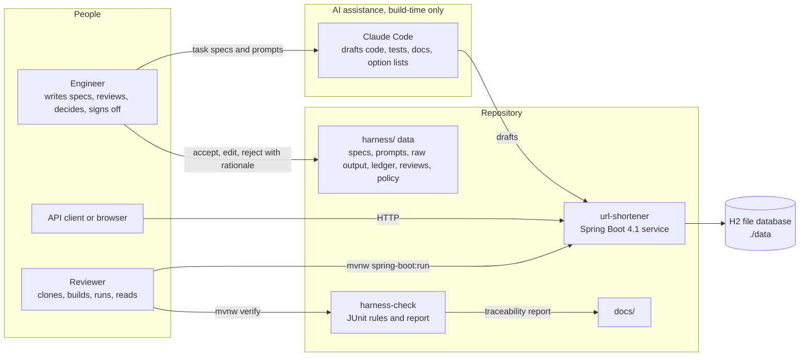
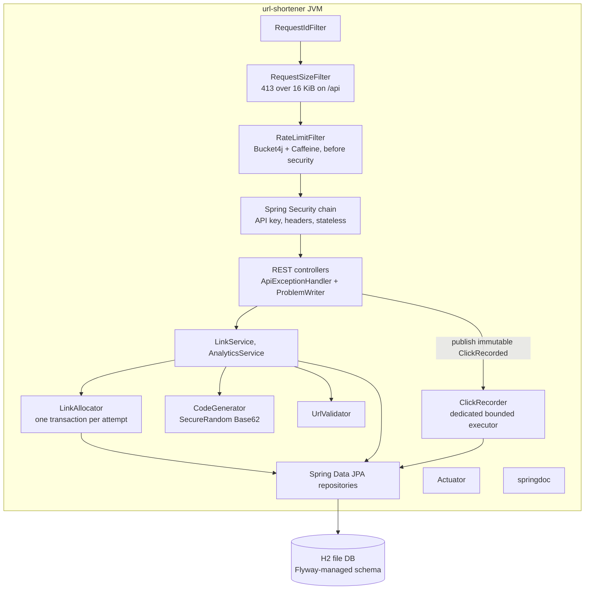
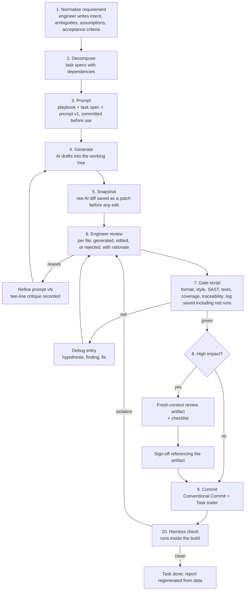
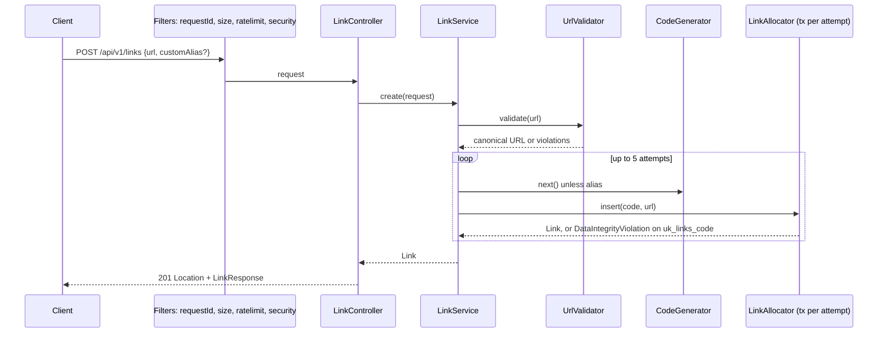
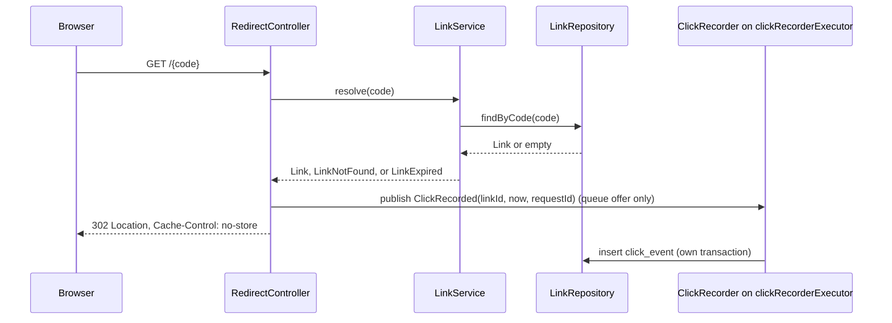
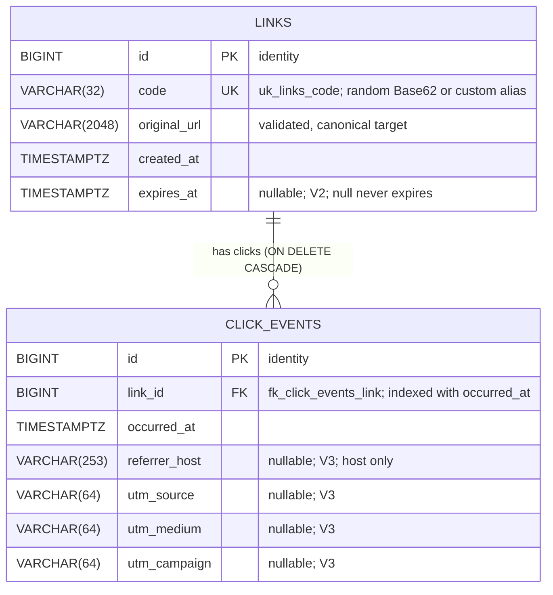

# Architecture overview

| Field | Value |
|---|---|
| Service | url-shortener, Spring Boot 4.1.1 on Java 21, one JVM, H2 file database |
| Owner | Harshil |
| Date | 2026-10-12 |
| Source of truth | [docs/design/2026-10-12-system-design.md](design/2026-10-12-system-design.md) |

## Purpose and scope

This is the architecture overview the assignment brief asks for: components, tools, execution approach, control flow, and key decisions. It describes the system as designed. Where a number depends on the build it says "filled at submission".

| In scope | Out of scope |
|---|---|
| One JVM serving create, redirect, metadata, stats, delete | User accounts, per-user ownership, per-user audit of deletes |
| H2 file database with a Flyway-managed schema | Active expiry purge or retention deletion |
| Asynchronous click recording and time-window stats | Distributed cache, queue, key generation service, rollup tables |
| API key authentication, rate limiting, security headers, Problem Details | Server-side fetching of target URLs |
| The engineering harness that makes the process checkable | Docker image, idempotency keys, load testing, CVE scanning in the build |

## Components

System context:

Container view of the service:

| Component | Responsibility | Depends on |
|---|---|---|
| `api` | Controllers, request and response records, `ApiExceptionHandler` extending `ResponseEntityExceptionHandler`, `ProblemWriter` shared with filters and the authentication entry point, OpenAPI customizer | `service` |
| `service` | `LinkService` (create loop, resolve, delete), `LinkAllocator` (single insert attempt in its own transaction), `AnalyticsService` (stats, read-only transaction), `CodeGenerator`, `UrlValidator`, `ClickRecorder` | `domain`, `repository` |
| `domain` | `Link` and `ClickEvent` entities, `ClickRecorded` event record, domain exceptions, `ReservedWords`, `LogSanitizer` | nothing |
| `repository` | Spring Data JPA interfaces with explicit JPQL projections | `domain` |
| `config` | `SecurityConfig` constructing the API key filter internally, `RateLimitFilter`, `RequestSizeFilter`, `RequestIdFilter` registered via `FilterRegistrationBean`, `ClickRecorderExecutorConfig`, `AppProperties` validated at startup, `OpenApiConfig` | Spring |
| `harness/` | The engineering system as data | nothing |
| `harness-check` | JUnit tests that read `harness/`, the source tree, and git history when available; failures are violations; writes the traceability report to `target/` | SnakeYAML, Boot-managed |
| `docs/` | Deliverable documents and the committed report snapshot | generated report |

## Logical services and their APIs

The service is one deployable, but its endpoints form four logical services with different traffic
shapes and protection. The code is organised along the same lines, and the design document (section
2.1) and the README carry the same table.

| Logical service | Endpoints | Main classes | Protection | Notes |
|---|---|---|---|---|
| Write path | `POST /api/v1/links` | `LinkController`, `LinkService`, `LinkAllocator`, `CodeGenerator`, `UrlValidator` | API key; rate limit before authentication; 16 KiB body cap | Random 7-character Base62 code or a client-supplied `customAlias`; one transaction per allocation attempt; 409 on a taken alias; optional `expiresAt` |
| Read path (hot) | `GET /{code}`, `HEAD /{code}` | `RedirectController`, `LinkService.resolve`, `ClickRecorder` on `clickRecorderExecutor` | Public; the path regex keeps noise such as `/favicon.ico` away from the database | One indexed lookup; 302 with `no-store`, 410 once expired; the click with its attribution is published as an immutable event and persisted asynchronously; `HEAD` resolves without counting |
| Management and analytics | `GET /api/v1/links/{code}`, `DELETE /api/v1/links/{code}`, `GET /api/v1/links/{code}/stats` | `LinkController`, `StatsController`, `AnalyticsService`, `ClickEventRepository` | API key | Metadata with the expiry state; hard delete with cascading click removal; one aggregate query for the totals plus the two top-ten attribution breakdowns |
| Platform | `/actuator/health`, `/actuator/info`, `/actuator/metrics`, `/actuator/prometheus`, `/v3/api-docs`, `/v3/api-docs.yaml`, `/swagger-ui.html` | Spring Boot Actuator, springdoc, `OpenApiConfig`, `OpenApiErrorCustomizer` | Health public; the other actuator endpoints behind the key in prod and open in dev; API docs public under their own Content-Security-Policy | Build info, custom counters, committed OpenAPI export drift-tested on every build |

## Tools

| Purpose | Tool | Version | Why this one |
|---|---|---|---|
| AI assistant | Claude Code with committed `AGENTS.md`, `CLAUDE.md`, deny rules | current | The tool the engineer uses; deny rules are deterministic where instruction files are advisory |
| Portable instructions | `.github/copilot-instructions.md` pointing to `AGENTS.md` | n/a | Portability of the custom instructions |
| Build | Maven Wrapper 3.3.4 pinned to Maven 3.9.16 | verified | Reviewers need no Maven install; offline rerun after first build |
| Framework | Spring Boot 4.1.1 on Java 21 | verified | 4.1.x OSS support to 2027-07-31; Java 21 is LTS and inside Boot's tested range |
| Persistence | Spring Data JPA, Hibernate 7.4.5, H2 2.4.240, Flyway 12.4.0 via `spring-boot-starter-flyway` | managed | Standard stack; H2 needs no install; Flyway makes schema change reviewable |
| API docs | springdoc-openapi-starter-webmvc-ui 3.1.1 | verified | The only springdoc line compatible with Boot 4 |
| Rate limiting | `com.bucket4j:bucket4j_jdk17-core` 8.21.0 with Caffeine 3.2.4 | verified | Token bucket; the old `bucket4j-core` coordinate is frozen; the Boot starter is RC-only for Boot 4.1 |
| Formatting | Spotless 3.10.4 with google-java-format 1.37.0 | verified | Non-configurable formatter removes style debates |
| Style rules | maven-checkstyle-plugin 3.6.0 with Checkstyle 14.3.0 and a project `checkstyle.xml` | verified | Engine must be overridden or the plugin silently uses 9.3; severity set to warning so Google rules fail |
| Bug patterns and SAST | spotbugs-maven-plugin 4.10.4.1 with findsecbugs-plugin 1.14.0, effort max, threshold medium | verified | Bytecode bug and security sink detection mapped to CWE |
| Coverage | jacoco-maven-plugin 0.8.15 | verified | Build-failing thresholds over one exec file |
| Tests | JUnit Jupiter 6.0.3, AssertJ 3.27.7, Mockito 5.23.0, Awaitility 4.3.0, Boot 4 test starters | managed | Surefire 3.5.6 is compatible with JUnit 6; Mockito needs the agent on JDK 21 |
| Latency smoke | HdrHistogram 2.2.2 | verified | Fixed-memory percentiles for one JUnit test |
| Dependency updates | Dependabot weekly for Maven and Actions | n/a | Zero install; works on private repos |
| Secret scanning | gitleaks-action v3 in CI; regex fallback in harness-check | verified | Free on private repos |
| Metrics | Micrometer 1.17 plus `micrometer-registry-prometheus` | managed | Prometheus endpoint is not in the actuator starter |
| CI | GitHub Actions, `actions/setup-java` Temurin 21 with Maven cache, matrix on Windows and Ubuntu, tag-triggered jar upload | current | Proves portability independently of the engineer's machine |

## Execution approach and control flow

AI drafts; the engineer decides at every step. AI drafts code, tests, docs, option lists, and omission checks on engineer-written analyses. The engineer writes requirements and specs, prompts, reviews every diff, records decisions, runs gates, signs off, and commits. The full description is in [execution-approach.md](execution-approach.md).

| Step | Owner | Output | Evidence file |
|---|---|---|---|
| 1 Normalize | Engineer; AI may list options to consider | `harness/requirements/R-0N.md` | Requirement record |
| 2 Decompose | Engineer | `harness/tasks/T-NNN.yaml` | Task specs |
| 3 Prompt | Engineer | `harness/prompts/T-NNN/v1.md`, later versions each with a critique | Prompt files, authentic by construction because the prompt references the file |
| 4 Generate | AI | Working tree diff | Not committed until reviewed |
| 5 Snapshot | Script | `harness/evidence/T-NNN/ai-raw.patch` and a pre-populated file list in the ledger | Raw output |
| 6 Review | Engineer | Ledger entry for the task with per-file status and rationale | `harness/ledger.yaml` |
| 7 Gates | Script | `harness/evidence/T-NNN/verify-N.log` and an appended gate record with real timestamps and the failing plugin on red | Ledger gate block |
| 8 Sign-off | Engineer | `harness/reviews/T-NNN.md` and a sign-off record pointing to it | Ledger sign-off block |
| 9 Commit | Engineer | Commit with `Task: T-NNN` trailer | Git history |
| 10 Harness check | Build | Test failures name the violated rule; `target/traceability.md`; a documented command copies it to `docs/reports/` | Report snapshot |

## Request flows

Create:

Redirect:

## Data model

Greenfield starts minimal on purpose so the brownfield scenario, and the ambiguous one if it chooses to, each require a real, reviewable migration. All migrations use the SQL subset accepted by both H2 in PostgreSQL mode and PostgreSQL, and each is proven by the `@DataJpaTest` that runs Flyway.

| Migration | Scenario | Change |
|---|---|---|
| `V1__create_links_and_click_events.sql` | Greenfield | `links(id BIGINT GENERATED BY DEFAULT AS IDENTITY PRIMARY KEY, code VARCHAR(32) NOT NULL, original_url VARCHAR(2048) NOT NULL, created_at TIMESTAMP WITH TIME ZONE NOT NULL, CONSTRAINT uk_links_code UNIQUE (code))`; `click_events(id BIGINT GENERATED BY DEFAULT AS IDENTITY PRIMARY KEY, link_id BIGINT NOT NULL, occurred_at TIMESTAMP WITH TIME ZONE NOT NULL, CONSTRAINT fk_click_events_link FOREIGN KEY (link_id) REFERENCES links(id) ON DELETE CASCADE)`; `CREATE INDEX ix_click_events_link_time ON click_events(link_id, occurred_at)` |
| `V2__add_link_expiry.sql` | Brownfield | `ALTER TABLE links ADD COLUMN expires_at TIMESTAMP WITH TIME ZONE` as a single-column statement |
| `V3__add_click_attribution.sql` | Ambiguous, decided in T-201 | Four single-column statements adding `referrer_host VARCHAR(253)`, `utm_source VARCHAR(64)`, `utm_medium VARCHAR(64)`, `utm_campaign VARCHAR(64)` to `click_events`, all nullable; one `ALTER TABLE ... ADD COLUMN` per column because H2 and PostgreSQL disagree on the multi-column form |

Entity relationship after V3 (the schema the service validates against at startup):

| Relation and index | Purpose |
|---|---|
| `links (1) to click_events (0..n)` through `click_events.link_id`, `ON DELETE CASCADE` | Deleting a link removes its history in the database, so the service needs no second statement |
| `uk_links_code` unique on `links.code` | The arbiter of code uniqueness; one indexed read on every redirect |
| `ix_click_events_link_time (link_id, occurred_at)` | Serves the statistics aggregate and the time windows |
| No IP, user agent or full referrer URL column anywhere | ADR 0006; `MigrationTest` asserts the exact seven columns of `click_events` |

In code the same model is the two JPA entities `domain/Link` and `domain/ClickEvent` (field names map one to one onto the columns above), the repositories `LinkRepository` and `ClickEventRepository`, and the three Flyway scripts under `url-shortener/src/main/resources/db/migration`. Hibernate validates entities against the migrated schema at every start, so the diagram, the SQL and the Java cannot drift silently.

| Rule | Reason |
|---|---|
| Entity time fields are `Instant`; columns are `TIMESTAMP WITH TIME ZONE` | Hibernate 7 maps `Instant` to `TIMESTAMP_UTC`; `ddl-auto=validate` passes only with time-zone columns |
| `ClickEvent.linkId` is a plain `Long`, not a relationship | Recording a click is one `INSERT` with no `SELECT` |
| `Link` has no collection of events | The database cascade handles deletion |
| `Link.equals` and `hashCode` use `code`; `toString` excludes `original_url` | Full URLs never leak through accidental logging |
| No IP or user-agent columns | ADR 0006 |

## Security controls

| Threat or standard | Control | Where |
|---|---|---|
| Open redirect by design (CWE-601) | Redirect only to the stored URL validated at create time; never reflect request input; scheme allow-list; non-enumerable codes | `UrlValidator`, `RedirectController` |
| Intranet link laundering | Reject private, loopback, link-local, and metadata hosts at create; residual DNS-based bypass documented | `UrlValidator` |
| Enumeration and key guessing | Random 7-character codes; rate limiter before authentication | `CodeGenerator`, filter order |
| Injection | JPA parameter binding only; FindSecBugs | repositories, build |
| Log injection (CWE-117) | `LogSanitizer` strips CR, LF, and control characters from user-controlled values before logging; never log full target URLs with query strings; client request ids bounded and sanitised | utility, filter, review checklist |
| XSS | API returns JSON only; Swagger UI is springdoc's vetted build under its own CSP | headers |
| Broken access control | API key on `/api/v1/**` and prod actuator; public only redirect, health, docs | `SecurityConfig` |
| Unrestricted resource consumption | Rate limit, 2048-character URL cap, 16 KiB body cap, bounded executor and queue, 2-second connection timeout | filters, properties |
| Secrets | No secrets in repo; env-based key; gitleaks in CI; regex fallback in harness-check; `.gitignore` for `.env*`, `data/`, `*.mv.db` | repo |
| Supply chain | All versions managed by the Boot BOM or pinned; every AI-suggested coordinate verified on Maven Central and recorded in the ledger with the URL; Dependabot | pom, ledger, CI |
| Security misconfiguration | Actuator exposure explicit; H2 console dev only; `ddl-auto=validate`; stack traces never in responses | properties |
| Privacy | No IP, no raw user agent; retention noted as a product decision | schema, ADR 0006 |

The threat model with trust boundaries and STRIDE is in [threat-model.md](threat-model.md).

## Observability

| Signal | Implementation |
|---|---|
| Health | `/actuator/health` with the database indicator; liveness and readiness groups; `show-details=always` in dev, `when-authorized` in prod |
| Build info | `spring-boot-maven-plugin` `build-info` goal so `/actuator/info` shows version and build time |
| Metrics | Auto `http.server.requests`, JVM, HikariCP; custom `shortener.links.created`, `shortener.redirects` tagged `outcome=hit|miss|expired`, `shortener.clicks.dropped` |
| Logs | Default pattern with `%X{requestId:-}` in dev; ECS structured JSON property set in prod and untested in this timebox; MDC cleared in `finally`; the click event carries `requestId` so the async log line correlates |
| Correlation | `RequestIdFilter` first in the chain; reads or generates `X-Request-Id`; echoes on the response; included in Problem Details |
| Tracing | Not included; Micrometer Tracing bridge is a documented addition |

## Configuration and profiles

| Profile | Datasource | Notable settings |
|---|---|---|
| `dev` (default) | `jdbc:h2:./data/urlshortener;MODE=PostgreSQL;DATABASE_TO_LOWER=TRUE;DEFAULT_NULL_ORDERING=HIGH;DB_CLOSE_ON_EXIT=FALSE` | H2 console on, health details always, dev API key default, rate limit 100 per minute, actuator open, human-readable logs |
| `test` | `jdbc:h2:mem:urlshortener;MODE=PostgreSQL;DATABASE_TO_LOWER=TRUE;DEFAULT_NULL_ORDERING=HIGH;DB_CLOSE_DELAY=-1`, applied by one `@ActiveProfiles("test")` meta-annotation on every test | Console off; fixed test API key; migrations validated in the same dialect mode as dev |
| `prod` | From `SPRING_DATASOURCE_URL` | Structured logs, console off, `APP_API_KEY` required, actuator behind API key, rate limit 20 per minute |

| Common setting | Value |
|---|---|
| `spring.application.name` | `url-shortener` |
| `spring.jpa.open-in-view` | `false` |
| `spring.jpa.hibernate.ddl-auto` | `validate` |
| `server.shutdown` | `graceful`, with a comment that it is the default |
| `spring.lifecycle.timeout-per-shutdown-phase` | `20s` |
| `spring.threads.virtual.enabled` | `false`, with a comment on H2 pinning |
| `spring.datasource.hikari.connection-timeout` | `2000` |
| `management.endpoints.web.exposure.include` | `health,info,metrics,prometheus` |
| `app.base-url` | optional; otherwise `shortUrl` is built from the request |
| `app.ratelimit.create.capacity` | 100 in dev, 20 in prod |
| `app.request.max-bytes` | `16384` |

Boot's own Problem Details property is left off because the project ships its own handler subclass, which is the single mechanism.

## Concurrency model

| Concern | Approach |
|---|---|
| Request handling | Platform threads, Tomcat defaults. Virtual threads are off because the H2 JDBC driver synchronises around every statement and pins carriers on Java 21 before JEP 491; the switch is one property once the driver is PostgreSQL's |
| Code uniqueness | Database unique constraint is the arbiter; no in-memory locking; one transaction per attempt |
| Click recording | Immutable event, dedicated bounded executor, drop-and-count on saturation, drained on shutdown; uses at most 4 of the 10 pool connections |
| Rate limiter | Bucket4j buckets are lock-free; Caffeine map is thread-safe and bounded at 10,000 entries with 10-minute expiry after access |
| Test isolation | Cached contexts share the in-memory database; every integration test cleans its tables in `@AfterEach` |

| Operation | Transaction boundary |
|---|---|
| Create | One transaction per allocation attempt inside `LinkAllocator`; the loop and validation are outside |
| Resolve for redirect | Repository finder, read-only transaction supplied by Spring Data |
| Stats | `@Transactional(readOnly = true)` on the service method |
| Delete | `@Transactional` on the service method; cascade in the database |
| Click insert | Repository save on the executor thread, its own transaction |

## Scaling path

| Concern | Prototype | Next step | Later |
|---|---|---|---|
| Database | H2 file | PostgreSQL by adding the two BOM-managed driver and Flyway artifacts and a datasource change | Read replicas |
| Hot redirect lookups | Indexed H2 read | Spring Cache with Caffeine, evict on delete and expiry | Redis cache provider, same `@Cacheable` code |
| Click analytics | Async insert, one aggregate query | Hourly rollup table with a watermark | Queue and streaming aggregation |
| Rate limiting | In-process Bucket4j | Bucket4j Redis backend | Edge rate limiting |
| Code generation | Random with retry | Pre-generated key pool handed out in blocks, or an obfuscated counter when decodable ids are needed | Key generation service |
| Instances | One | Stateless nodes behind a load balancer with trusted-proxy configuration | Multi-region |

## Failure scenarios

| Failure | Behaviour | Test or evidence |
|---|---|---|
| Database unavailable | API responses 503 with `Retry-After` within 2 seconds; health reports the database DOWN | Documented behaviour; exception mapping unit-tested |
| Analytics insert fails | Redirect still 302; `clicks.dropped` increments; error logged once per event | `ClickRecordingIT.redirectSurvivesAnalyticsFailure` |
| Executor saturated | Drop and count; request thread never blocks | `ClickRecorderExecutorTest` |
| Code collision | Retry up to 5 in separate transactions | `LinkAllocatorTest` on a real database |
| Process killed mid-flight | Graceful shutdown waits up to 20 seconds; executor drains up to 10 seconds; events still queued after that are lost | Documented limitation |
| Clock skew on expiry | All comparisons in UTC with an injected `Clock` | `ExpiryIT` uses a fixed clock |

## Key decisions

| ADR | Decision | Rejected | Deciding factor |
|---|---|---|---|
| [0001](decisions/0001-java-21-spring-boot-4-maven-wrapper.md) | Java 21, Spring Boot 4.1.1, Maven Wrapper | Boot 3.5, Java 25, Gradle | Role requires Java; 4.1.x supported to mid-2027; reviewers' JDK |
| [0002](decisions/0002-h2-file-mode-with-flyway-migrations.md) | H2 file mode, Flyway, `ddl-auto=validate` | PostgreSQL via Docker, SQLite, in-memory only | No Docker or admin on reviewer laptops; schema change control |
| [0003](decisions/0003-random-base62-codes-with-per-attempt-transactions.md) | Random Base62 with per-attempt transactions | Counter including Redis `INCR`, hash, Snowflake | Non-enumerable, no infrastructure, correct under races |
| [0004](decisions/0004-302-redirect-with-no-store.md) | 302 with explicit `no-store` | 301, 307 | 301 is heuristically cacheable; clicks and expiry would be lost |
| [0005](decisions/0005-click-events-table-with-async-recording.md) | Events table, async insert, one aggregate query | Counter column, rollups, synchronous insert | Hot-row serialisation; redirect isolation |
| [0006](decisions/0006-no-ip-or-user-agent-persisted.md) | No IP or raw user agent persisted | Truncated IP, salted hash | Regulated-firm privacy posture; GDPR Recital 30 |
| [0007](decisions/0007-spring-security-api-key-and-rate-limiter-before-auth.md) | Spring Security chain, API key, limiter before authentication | Bare filter; limiter after authentication | Expected by enterprise reviewers; throttles key guessing |
| [0008](decisions/0008-process-as-code-with-harness-check.md) | Process as code with a JUnit validator module | Markdown only; mini platform; JSON Schema files | Checkable traceability, product code untouched |
| [0009](decisions/0009-task-trailer-and-ledger-provenance.md) | `Task:` trailer in commits, AI provenance in the ledger | `Assisted-by:` trailers | Repository convention; ledger is the richer record |

Smaller decisions:

| Decision | Reason |
|---|---|
| RFC 9457 Problem Details via one `ResponseEntityExceptionHandler` subclass and one `ProblemWriter` | One error shape from controllers, filters, and the authentication entry point |
| Platform threads rather than virtual threads | H2's JDBC driver pins carriers on Java 21; one property flips it on PostgreSQL |
| Hard delete with database cascade | Timebox; the alias-reclaim risk is recorded as RK-12 |
| No server-side fetch of target URLs | Adds a fetch surface and needs keys; the threat addressed is link laundering, not SSRF |
| No rollup tables | Premature for one node; the scaling path names them |
| Expired rows retained | Correct 410 and preserved click history over disk economy |

## Companion diagrams

The self-contained HTML companion with the system context, logical services, container, request lanes, algorithm math, and data model diagrams is at [design/system-design-overview.html](design/system-design-overview.html). Open it directly in a browser; it has no external assets.
