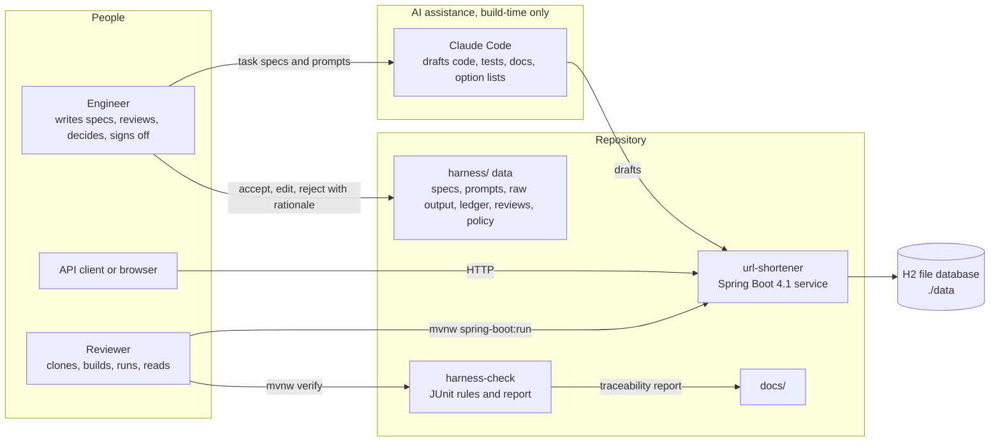
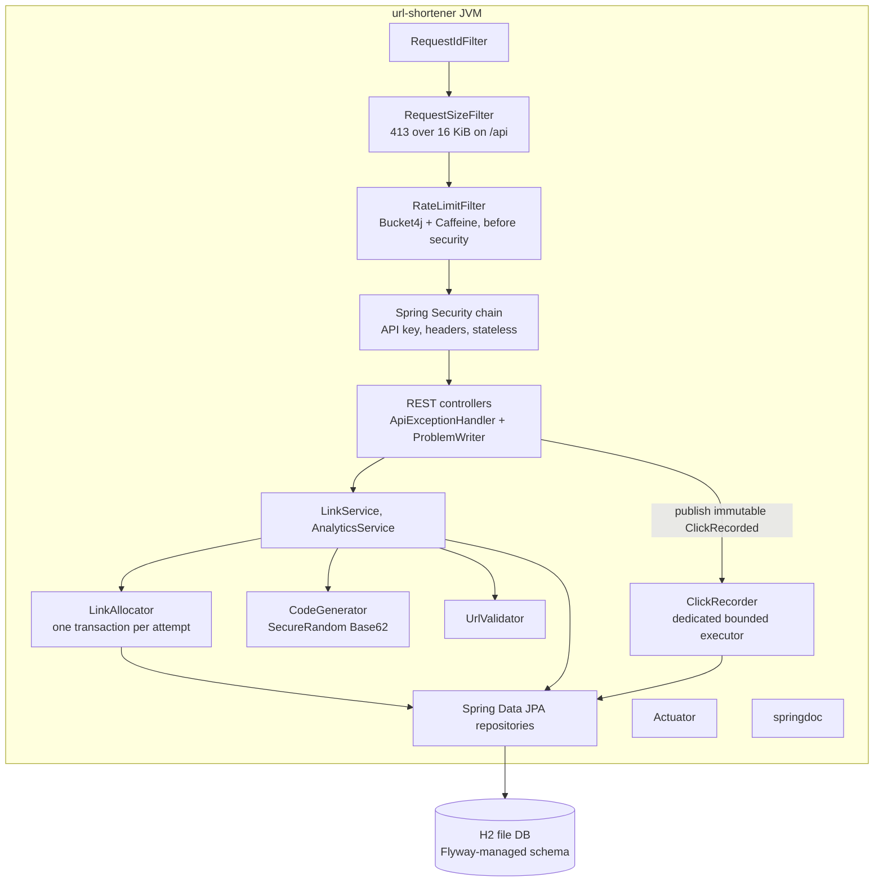
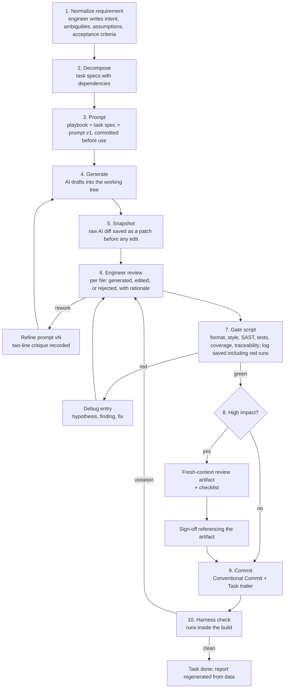
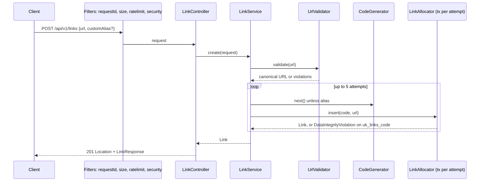
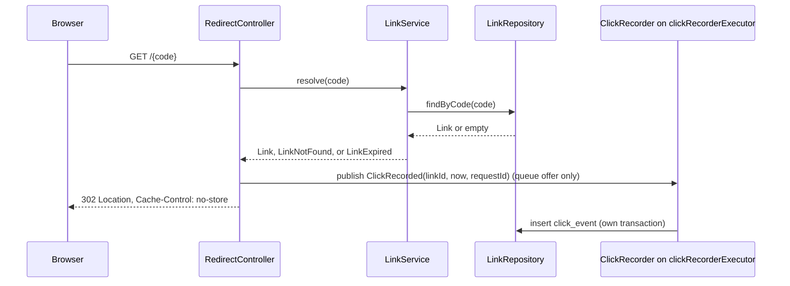
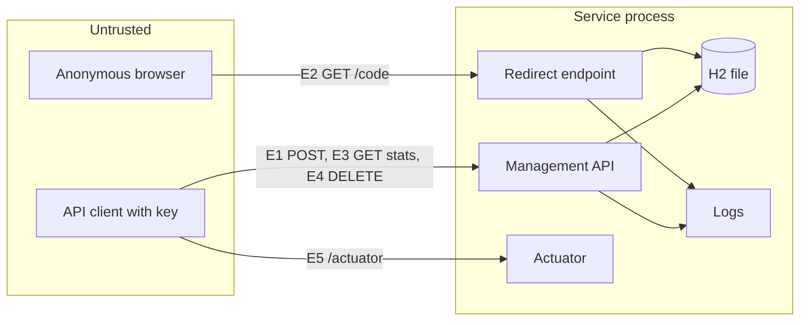

# AI-Assisted URL Shortener: System Design and Engineering Approach

| Field | Value |
|---|---|
| Status | v2, revised after three independent design reviews, awaiting engineer approval |
| Date | 2026-10-12 |
| Owner | Harshil, the engineer accountable for every line shipped |
| Scope | The assignment brief for an AI-assisted software engineering role: a URL shortener delivered through engineer-led, AI-accelerated, auditable execution |
| Timebox | Evening of 2026-10-12 through 2026-10-15 |
| Reviewer environment assumed | Locked-down Windows laptop, JDK 21, no Docker, no admin rights, no API keys, possibly a corporate proxy, about one hour of attention |

This is the master design. During the build it is carved into the deliverable documents listed in section 2.5. Every artifact version was verified on Maven Central or the vendor's release page on 2026-10-12. Changes from v1 are summarised in section 13.

---

## 1. Requirement normalization

### 1.1 The assignment as an engineering problem

| Question | Answer |
|---|---|
| What is being built | A production-grade URL shortener service, delivered through a disciplined and auditable AI-assisted process, plus the lightweight harness that makes that discipline checkable |
| Who it is for | Reviewers who will clone, build, run, and read the repository, then question the engineer on every decision |
| What success looks like | The build is green on a clean Windows laptop with JDK 21; the service runs with one command; three scenario documents show decomposition, execution, and validation with evidence captured during the work, not reconstructed afterwards; every AI-assisted change traces to a task spec, a prompt, the raw AI output, a review decision, gate results, and a sign-off where required |
| What is explicitly not wanted | Autonomous orchestration. The engineer leads; AI drafts inside tasks; the engineer decides at every step |
| The critical differentiator | AI used across implementation, debugging, refactoring, test generation, documentation, and review preparation, with task specs, disciplined prompting, traceability of generated, edited, and rejected output, quality gates, secure AI usage, human sign-off, and engineer ownership |

### 1.2 Functional requirements

Statements use EARS form with RFC 2119 keywords. Each row names the scenario that delivers it and the test that proves it.

| ID | Requirement | Priority | Scenario | Acceptance test |
|---|---|---|---|---|
| FR-01 | When a client POSTs a valid absolute http or https URL as JSON, the system SHALL create a link with a unique 7-character Base62 code and respond 201 with `Location` and the link body | Must | Greenfield | `LinkFlowIT.createsLinkAndReturns201` |
| FR-02 | When a client supplies a custom alias matching `^[A-Za-z0-9_-]{4,32}$` that is not reserved and not taken, the system SHALL use it as the code | Must | Greenfield | `LinkFlowIT.acceptsCustomAlias` |
| FR-03 | If a custom alias is already taken, including when two requests race, then the system SHALL respond 409 | Must | Greenfield | `LinkAllocatorTest.aliasRaceMapsTo409` on a real database |
| FR-04 | If the URL is not absolute http or https, contains credentials, exceeds 2048 characters, or targets loopback, private, link-local, or cloud-metadata hosts, then the system SHALL respond 400 with field errors | Must | Greenfield | `UrlValidatorTest`, `LinkControllerTest.rejectsInvalidUrls` |
| FR-05 | When a client GETs `/{code}` for a known live link, the system SHALL respond 302 with `Location` set to the stored URL and `Cache-Control` containing `no-store` | Must | Greenfield | `RedirectIT.redirectsWith302` |
| FR-06 | If the code is unknown or malformed, then the system SHALL respond 404 without a database lookup for malformed codes | Must | Greenfield | `RedirectIT.unknownCodeIs404` |
| FR-07 | When a redirect is served, the system SHALL record a click event off the request thread; the request thread SHALL only hand an immutable event to a bounded queue | Must | Greenfield | `ClickRecordingIT.recordsClickAfterRedirect`, `ClickRecorderExecutorTest.rejectionIsCountedNotBlocking` |
| FR-08 | When a client GETs `/api/v1/links/{code}/stats`, the system SHALL return total clicks, clicks in the last 24 hours, clicks in the last 7 days, and last-clicked time | Must | Greenfield | `StatsIT.returnsCounts` |
| FR-09 | When a client GETs or DELETEs `/api/v1/links/{code}`, the system SHALL return metadata or delete the link and its events | Must | Greenfield | `LinkManagementIT` |
| FR-10 | While a request targets `/api/v1/**`, the system SHALL require a valid `X-API-Key` header and respond 401 with `WWW-Authenticate` otherwise | Must | Greenfield | `ApiKeyIT` with wrong, missing, correct, and public-redirect cases |
| FR-11 | If a client exceeds the create rate limit, then the system SHALL respond 429 with `Retry-After` | Must | Greenfield | `RateLimitIT` |
| FR-12 | The system SHALL expose health, info, metrics, and Prometheus endpoints, an OpenAPI 3.1 document that matches the committed copy, and Swagger UI that works in a browser with an Authorize button | Must | Greenfield | `ActuatorIT`, `OpenApiIT.committedSpecMatchesRuntime`, manual browser check recorded in the scenario doc |
| FR-13 | When a link is created with `expiresAt` as an RFC 3339 timestamp with offset, the system SHALL reject past values and zoneless strings with 400 | Must | Brownfield | `ExpiryIT.rejectsPastAndZoneless` |
| FR-14 | While a link's `expiresAt` is in the past, the system SHALL respond 410 with `Cache-Control` containing `no-store` on redirect, SHALL keep the row and its click history, and SHALL report `expired: true` in metadata and stats | Must | Brownfield | `ExpiryIT.expiredLinkIs410AndStatsRemain` with a fixed clock |
| FR-15 | The outcome of the ambiguous requirement "marketing wants to know where clicks come from" is determined by task T-201 and recorded there; this design deliberately does not pre-decide it | Must | Ambiguous | Defined in T-201 |

### 1.3 Non-functional requirements

| ID | Quality | Requirement | Measure | How verified |
|---|---|---|---|---|
| NFR-01 | Portability | Builds and runs on Windows and Linux with JDK 21 and no other installs | `mvnw verify` green on both | CI matrix `windows-latest` and `ubuntu-latest` |
| NFR-02 | Performance | Redirect path is one indexed read; hand-off to analytics is a queue offer | p99 under 200 ms over 2,000 in-process requests after warm-up, a smoke threshold, not a capacity claim | `RedirectLatencySmokeTest` tagged `perf`, run in the Ubuntu CI job |
| NFR-03 | Reliability | Analytics failure or saturation never fails or delays a redirect beyond the queue offer | Redirect returns 302 while event persistence throws or the queue is full | `ClickRecordingIT.redirectSurvivesAnalyticsFailure`, `ClickRecorderExecutorTest` |
| NFR-04 | Reliability | Graceful shutdown completes in-flight requests and drains queued click events for up to 10 seconds | Boot default plus executor drain settings | Config review, documented |
| NFR-05 | Security | No redirect beyond the stored pre-validated URL; codes non-enumerable; management endpoints authenticated; key guessing rate limited; security headers present | Tests plus SpotBugs with FindSecBugs clean | `SecurityHeadersIT`, `ApiKeyIT`, `RateLimitIT.limitsUnauthenticatedCreates`, static analysis gate |
| NFR-06 | Privacy | No IP addresses or raw user-agent strings persisted | Schema has no such columns; review | Schema review, `ClickEventTest` |
| NFR-07 | Observability | Every request carries a bounded, sanitised correlation id in logs and error bodies; counters for creates, redirect outcomes, and dropped clicks | Log pattern and `/actuator/metrics` | `ActuatorIT`, `ProblemDetailIT` |
| NFR-08 | Maintainability | Layered packages, methods under 50 lines, files under 400 lines, constructor injection only | Project Checkstyle config with `MethodLength`, `FileLength`, and a regex check against field injection | Style gate |
| NFR-09 | Testability | Line coverage at least 80 percent, branch at least 70 percent, no production class untouched, all tests under one runner so integration coverage counts | JaCoCo check over a single exec file | Coverage gate fails build |
| NFR-10 | Change safety | Schema changes versioned, reviewable, validated at startup, and written in the SQL subset H2's PostgreSQL mode and PostgreSQL both accept | Flyway migrations, `ddl-auto=validate`, `@DataJpaTest` proving each migration | Startup fails on drift |
| NFR-11 | Auditability of process | Every task traceable from spec to prompt to raw AI output to review decisions to gate results to commit, with sign-off where required | Zero violations from harness-check | `harness-check` tests in the default build |

### 1.4 Assumptions and out of scope

| Assumption | Rationale |
|---|---|
| Single node, embedded H2 in file mode | Reviewers have no Docker or admin rights; the scaling path is documented, not built |
| Read to write ratio around 10:1, following the common system design treatments | Drives the decision to keep the redirect path minimal and analytics asynchronous |
| The engineer plays the stakeholder for the ambiguous scenario and records dated questions before dated answers | No real marketing team exists; the decision record is the evidence |
| Reviewers may run on plain HTTP | HSTS will not appear locally; documented |
| Private GitHub repository with reviewers invited as collaborators, pending the engineer's confirmation | Controls who sees it; gitleaks and Dependabot replace the paid GitHub scanning features |

| Out of scope | Why |
|---|---|
| User accounts, per-user ownership, per-user audit of deletes | Not in the brief; one API key suffices for a prototype and is listed as a limitation |
| Active expiry purge or retention deletion | Expired rows are kept so 410 and history survive; purge is a documented next step |
| Distributed cache, queue, key generation service, rollup tables | Scaling path only |
| Server-side fetching of target URLs | Adds a fetch surface and needs API keys; a local deny-list hook is designed, not populated |
| Idempotency keys, load testing, dependency CVE scanning in the default build, compile-time semantic checks beyond the compiler | Cut after feasibility review; each has a one-line "how we would" in the limitations document |
| Docker image | Optional only after all three scenarios are complete |

### 1.5 Ambiguities in the assignment and chosen reading

| Ambiguity | Reading adopted |
|---|---|
| "Runnable end-to-end" | The service runs from one command; the harness checks run inside the same `mvnw verify` as the product tests |
| Whether AI must be used live by reviewers | No. AI assistance is the engineer's tool during the build; reviewers see the evidence |
| "Reliability features" | Health and readiness, graceful shutdown with executor drain, validation, rate limiting, request size limits, Problem Details errors, correlation ids, async isolation of analytics, 503 with `Retry-After` when the database is unavailable |
| "Analytics" | Per-click events with time-window counts; richer attribution only if the ambiguous scenario decides so |
| "Human sign-off for high-impact changes" | The changes that would go to a senior engineer on a real team: schema, security, data deletion, dependencies. Sign-off references a review artifact, not just a stanza |
| "Secure AI usage" | A written policy where each control states whether it is enforced by a mechanism or attested by the engineer |
| "Review preparation" | A fresh-context review artifact per high-impact task, the pull request template, and the generated traceability report |

---

## 2. Architecture overview

### 2.1 Components

System context:



Container view of the service:



| Component | Responsibility | Depends on |
|---|---|---|
| `api` | Controllers, request and response records, `ApiExceptionHandler` extending `ResponseEntityExceptionHandler`, `ProblemWriter` shared with filters and the authentication entry point, OpenAPI customizer | `service` |
| `service` | `LinkService` (create loop, resolve, delete), `LinkAllocator` (single insert attempt in its own transaction), `AnalyticsService` (stats, read-only transaction), `CodeGenerator`, `UrlValidator`, `ClickRecorder` | `domain`, `repository` |
| `domain` | `Link`, `ClickEvent` entities, `ClickRecorded` event record, domain exceptions, `ReservedWords`, `LogSanitizer` | nothing |
| `repository` | Spring Data JPA interfaces with explicit JPQL projections | `domain` |
| `config` | `SecurityConfig` constructing the API key filter internally, `RateLimitFilter`, `RequestSizeFilter`, `RequestIdFilter` registered via `FilterRegistrationBean`, `ClickRecorderExecutorConfig`, `AppProperties` validated at startup, `OpenApiConfig` | Spring |
| `harness/` | The engineering system as data | nothing |
| `harness-check` | JUnit tests that read `harness/`, the source tree, and git history when available; failures are violations; writes the traceability report to `target/` | SnakeYAML (Boot-managed) |
| `docs/` | Deliverable documents and the committed report snapshot | generated report |

### 2.2 Tools

| Purpose | Tool | Version | Why this one |
|---|---|---|---|
| AI assistant | Claude Code with committed `AGENTS.md`, `CLAUDE.md`, deny rules | current | The tool the engineer actually uses; the role names it; deny rules are deterministic where instruction files are advisory |
| Portable instructions | `.github/copilot-instructions.md` pointing to `AGENTS.md` | n/a | Role responsibility "maintain custom instructions"; portability |
| Build | Maven Wrapper 3.3.4 pinned to Maven 3.9.16 | verified | Reviewers need no Maven install; offline rerun after first build |
| Framework | Spring Boot 4.1.1 on Java 21 | verified | 4.1.x has OSS support to 2027-07-31; 4.0.x ends 2026-12-31; Java 21 is LTS and inside Boot's tested range |
| Persistence | Spring Data JPA, Hibernate 7.4.5, H2 2.4.240, Flyway 12.4.0 via `spring-boot-starter-flyway`, all Boot-managed | managed | Standard enterprise stack; H2 needs no install; Flyway makes schema change reviewable; PostgreSQL support needs two BOM-managed artifacts and is untested in this timebox |
| API docs | springdoc-openapi-starter-webmvc-ui 3.1.1 | verified | The only springdoc line compatible with Boot 4 |
| Rate limiting | `com.bucket4j:bucket4j_jdk17-core` 8.21.0 with Caffeine 3.2.4 (managed) | verified | Token bucket; the old `bucket4j-core` coordinate is frozen; the Boot starter is RC-only for Boot 4.1 |
| Formatting | Spotless 3.10.4 with google-java-format 1.37.0 | verified | Non-configurable formatter removes style debates |
| Style rules | maven-checkstyle-plugin 3.6.0 with Checkstyle 14.3.0 and a project `checkstyle.xml` copied from `google_checks.xml` plus `MethodLength`, `FileLength`, and a field-injection regex | verified | The engine must be overridden or the plugin silently uses 9.3; severity must be set to warning or the Google rules never fail |
| Bug patterns and security SAST | spotbugs-maven-plugin 4.10.4.1 with findsecbugs-plugin 1.14.0, effort max, threshold medium | verified | Bytecode bug and security sink detection mapped to CWE |
| Coverage | jacoco-maven-plugin 0.8.15 | verified | Build-failing thresholds over one exec file |
| Tests | JUnit Jupiter 6.0.3, AssertJ 3.27.7, Mockito 5.23.0, Awaitility 4.3.0, Boot 4 test starters, all managed | managed | Surefire 3.5.6 managed is compatible with JUnit 6; Mockito needs the agent `argLine` on JDK 21 |
| Latency smoke | HdrHistogram 2.2.2 | verified | Fixed-memory percentiles for one JUnit test |
| Dependency updates and vulnerabilities | Dependabot weekly for Maven and Actions | n/a | Zero install, works on private repos; CVE scanning with NVD data is documented as the next step |
| Secret scanning | gitleaks-action v3 in CI; regex fallback in harness-check | verified | Free on private repos |
| Metrics | Micrometer 1.17 (managed) plus `micrometer-registry-prometheus` | managed | Prometheus endpoint is not in the actuator starter |
| CI | GitHub Actions, `actions/setup-java` Temurin 21 with Maven cache, matrix on Windows and Ubuntu, tag-triggered jar upload | current | Proves portability independently of the engineer's machine |

### 2.3 Execution approach and control flow

AI drafts; the engineer decides at every step. What AI drafts: code, tests, docs, option lists, and omission checks on engineer-written analyses. What the engineer does: writes requirements and specs, prompts, reviews every diff, records decisions, runs gates, signs off, commits.



| Step | Owner | Output | Evidence file |
|---|---|---|---|
| 1 Normalize | Engineer; AI may list options to consider | `harness/requirements/R-0N.md` | Requirement record |
| 2 Decompose | Engineer | `harness/tasks/T-NNN.yaml` | Task specs |
| 3 Prompt | Engineer | `harness/prompts/T-NNN/v1.md`, later versions each with a critique | Prompt files, authentic by construction because the prompt references the file |
| 4 Generate | AI | Working tree diff | Not committed until reviewed |
| 5 Snapshot | Script | `harness/evidence/T-NNN/ai-raw.patch` and a pre-populated file list in the ledger | Raw output |
| 6 Review | Engineer | Ledger entry for the task with per-file status and rationale | `harness/ledger.yaml` |
| 7 Gates | Script | `harness/evidence/T-NNN/verify-N.log` and an appended gate record with real timestamps and the failing plugin on red | Ledger gate block |
| 8 Sign-off | Engineer | `harness/reviews/T-NNN.md` and a sign-off record pointing to it | Ledger sign-off block |
| 9 Commit | Engineer | Commit with `Task: T-NNN` trailer | Git history |
| 10 Harness check | Build | Test failures name the violated rule; `target/traceability.md`; a documented command copies it to `docs/reports/` | Report snapshot |

### 2.4 Key decisions

Nine full decision records in MADR format under `docs/decisions/`. Smaller decisions live in a table inside the architecture document.

| ADR | Decision | Alternatives considered | Deciding factors |
|---|---|---|---|
| 0001 | Java 21 with Spring Boot 4.1.1 and Maven Wrapper | Boot 3.5 (OSS support ended June 2026), Java 25 (newer LTS, less common in enterprises), Gradle | Role requires Java; reviewers' JDK; support window; must show rejected Boot 3 idioms in the ledger so the choice is not resume-driven |
| 0002 | H2 in file mode with Flyway migrations, JPA with `ddl-auto=validate`, migrations written in the H2-and-PostgreSQL SQL intersection | PostgreSQL via Docker, SQLite, in-memory only | No Docker or admin for reviewers; schema change control |
| 0003 | Random 7-character Base62 codes from SecureRandom, uniqueness enforced by a named unique constraint, bounded retry with one transaction per attempt | Base62 of a counter, including the Redis `INCR` design with block reservation and per-region ranges that the common interview treatment ends on; hash of the URL; Snowflake ids | Keyspace of 62^7 is about 3.5 trillion; about 0.14 expected collisions while inserting the first million links; non-enumerable by construction, where a counter needs obfuscation that is reversible and therefore not a security control; no extra infrastructure. The counter design is the right switch when multiple write instances need decodable ids |
| 0004 | 302 redirect with `Cache-Control: no-store` set by the controller | 301 (heuristically cacheable under RFC 9110, undercounts clicks, blocks expiry), 307 (identical for GET) | Every click must reach the server for analytics and enforcement |
| 0005 | Click events table as single source of truth, written off the request thread by a dedicated bounded executor; totals are one indexed aggregate query | Counter column per redirect (hot row), rollup tables (premature), synchronous insert (breaks NFR-03) | Isolation of analytics from redirects, the same rule bitly applies |
| 0006 | No IP addresses or raw user agents persisted | Truncated IP, salted daily hash | Regulated-firm privacy posture; a click log with raw IP and user agent is personal data under GDPR Recital 30 |
| 0007 | Spring Security 7 stateless chain with an API key filter constructed inside the configuration, security headers, and the rate limiter placed before the chain | Plain filter without Spring Security; rate limiter after authentication | Enterprise reviewers expect Spring Security; headers come with it; limiting before authentication also throttles key guessing |
| 0008 | Process as code: YAML task specs and ledger validated by JUnit tests in a separate module, raw AI output captured before review | Markdown-only process evidence; a mini platform; JSON Schema files nothing validates | Checkable traceability without polluting product code; about 300 lines of Java |
| 0009 | Commits carry a `Task:` trailer only; AI tool and model are named in the ledger entry the trailer resolves to; README carries the accountability statement | `Assisted-by:` commit trailers | Repository convention keeps commit messages free of AI references; the ledger is the richer and reviewable record, and the mapping is one command |

Smaller decisions recorded in the architecture document's decision table: RFC 9457 Problem Details via one `ResponseEntityExceptionHandler` subclass and one `ProblemWriter`; platform threads rather than virtual threads because H2's JDBC driver pins carriers on Java 21; hard delete with cascade and the alias-reclaim risk recorded; no server-side fetch of target URLs; no rollups; expired rows retained.

### 2.5 How this design becomes the deliverables

| Deliverable in the assignment | File | Derived from |
|---|---|---|
| Working prototype | `url-shortener/` plus `docs/fresh-clone-transcript.md` recording a timed clone, build, run, and API walkthrough on a clean profile | Sections 3 and 7 |
| Architecture overview: components, tools, execution approach, control flow, key decisions | `docs/architecture.md` | Section 2 |
| Execution approach in depth | `docs/execution-approach.md` | Sections 2.3 and 5 |
| Evidence of AI-assisted execution | `harness/` and `docs/reports/traceability.md` | Section 5 and the build |
| Three scenarios, each with decomposition, execution, validation | `docs/scenarios/greenfield.md`, `brownfield.md`, `ambiguous.md`, written incrementally: normalization and decomposition before the first task, evidence links as tasks complete, validation last | Section 6 |
| Setup instructions | `README.md` with ten, thirty, and sixty minute reading paths and the reviewer-path checklist | Sections 3.9 and 7 |
| Testing approach | `docs/testing.md` | Section 4.2 |
| Limitations and trade-offs | `docs/risks-and-limitations.md` | Sections 8 and 10 |
| Final engineering summary | `docs/engineering-summary.md` with the headings plan and rationale, artifacts, risks and trade-offs and validation, assumptions, limitations, plus "what the AI got wrong and what I rejected" with the harness ratios | Whole document plus build outcomes |
| Decision records | `docs/decisions/0001` to `0009` | Section 2.4 |
| API reference including the error catalogue | `docs/reference/api.md`, `docs/reference/openapi.yaml` | Sections 3.3 and 3.4 |
| Threat model | `docs/threat-model.md` | Section 9 |
| Release | Tag `v0.1.0`; CI uploads the jar on tag | Section 4.5 |

---

## 3. URL shortener design

### 3.1 Stack and versions

| Layer | Choice | Version | Source of version |
|---|---|---|---|
| Runtime | Eclipse Temurin JDK 21 | 21.0.12 | Adoptium API; available as a zip for no-admin installs |
| Build | Maven 3.9.16 via wrapper 3.3.4 | verified | Maven history page |
| Parent | `spring-boot-starter-parent` | 4.1.1 | Maven Central metadata |
| Web | `spring-boot-starter-webmvc` | managed | Boot 4 renamed from `starter-web` |
| Data | `spring-boot-starter-data-jpa`, `spring-boot-starter-flyway`, `com.h2database:h2` | managed | Boot 4.1.1 BOM |
| Validation | `spring-boot-starter-validation` | managed | Jakarta Validation 3.1 |
| Security | `spring-boot-starter-security` | managed | Spring Security 7.1.1 |
| Ops | `spring-boot-starter-actuator`, `micrometer-registry-prometheus` | managed | |
| API docs | `springdoc-openapi-starter-webmvc-ui` | 3.1.1 | springdoc.org |
| Rate limit | `bucket4j_jdk17-core` | 8.21.0 | Maven Central metadata |
| Cache map | `com.github.ben-manes.caffeine:caffeine` | managed 3.2.4 | |
| Tests | `spring-boot-starter-webmvc-test`, `spring-boot-starter-data-jpa-test`, `spring-boot-starter-security-test` | managed | Boot 4 test starters |
| Perf test | `org.hdrhistogram:HdrHistogram` | 2.2.2 | Maven Central |

Build-time plugin versions are in section 4.1.

### 3.2 Package layout

```
url-shortener/src/main/java/dev/harshil/shortener/
  UrlShortenerApplication.java
  api/        LinkController, RedirectController, StatsController,
              dto/ CreateLinkRequest, LinkResponse, StatsResponse (records, boxed types, @NotNull),
              ApiExceptionHandler (extends ResponseEntityExceptionHandler),
              ProblemWriter, ProblemTypes, OpenApiErrorCustomizer
  service/    LinkService, LinkAllocator, AnalyticsService, CodeGenerator, UrlValidator, ClickRecorder
  domain/     Link, ClickEvent, ClickRecorded, LinkNotFoundException, AliasTakenException,
              LinkExpiredException, ReservedWords, LogSanitizer
  repository/ LinkRepository, ClickEventRepository
  config/     SecurityConfig (+ ApiKeyFilter as a nested or package-private class),
              RateLimitFilter, RequestSizeFilter, RequestIdFilter, FilterRegistrations,
              ClickRecorderExecutorConfig, AppProperties, OpenApiConfig
```

Package name `dev.harshil.shortener` is confirmed.

### 3.3 API contract

Base path for management is `/api/v1`. Redirects are at the root. All error bodies are `application/problem+json`, whether produced by a controller, a filter, or the authentication entry point.

| Method and path | Auth | Request | Success | Errors |
|---|---|---|---|---|
| `POST /api/v1/links` | API key | `application/json` only; `{ "url": string, "customAlias"?: string, "expiresAt"?: RFC 3339 with offset (brownfield) }` | 201, `Location: /api/v1/links/{code}`, body `LinkResponse` | 400 validation, 401, 409 alias taken, 413 body too large, 415 wrong content type, 429, 503 |
| `GET /{code:[A-Za-z0-9_-]{4,32}}` | none | path code | 302, `Location`, `Cache-Control: no-store` | 404, 410 expired (brownfield), 503 |
| `HEAD /{code}` | none | | Same status as GET, not counted as a click | |
| `GET /api/v1/links/{code}` | API key | path code | 200 `LinkResponse` | 401, 404 |
| `GET /api/v1/links/{code}/stats` | API key | path code | 200 `StatsResponse` | 401, 404 |
| `DELETE /api/v1/links/{code}` | API key | path code | 204 | 401, 404 |
| `GET /actuator/health`, `/health/liveness`, `/health/readiness` | none | | 200 or 503 | |
| `GET /actuator/info`, `/metrics`, `/prometheus` | API key in prod profile, open in dev | | 200 | |
| `GET /v3/api-docs`, `/v3/api-docs.yaml`, `/swagger-ui.html` | none | | 200 | |

Response records:

| Record | Fields |
|---|---|
| `LinkResponse` | `code`, `shortUrl`, `url`, `createdAt`, `expiresAt` nullable and `expired` boolean (brownfield) |
| `StatsResponse` | `code`, `totalClicks`, `clicksLast24h`, `clicksLast7d`, `lastClickedAt`, `expiresAt`, `expired` (brownfield); any attribution fields only if T-201 decides so |

`shortUrl` is built from `app.base-url` when set, otherwise from the current request's scheme, host, and port, so a reviewer on another port sees correct values.

Headers on every response: `X-Request-Id` (echoed when the client's value is at most 64 characters of `[A-Za-z0-9-]`, otherwise generated), `X-Content-Type-Options: nosniff`, `X-Frame-Options: DENY`, `Referrer-Policy: no-referrer`, and Spring Security's default `Cache-Control` block, which already contains `no-store`. Redirect and 410 responses set `Cache-Control: no-store` explicitly through the controller so the intent is visible in code and tests. A Content-Security-Policy is applied only to Swagger UI paths with `default-src 'self'; style-src 'self' 'unsafe-inline'; img-src 'self' data:; frame-ancestors 'none'; object-src 'none'`, because the stricter policy blanks the UI. `Strict-Transport-Security` appears only on HTTPS, documented. 401 responses carry `WWW-Authenticate: ApiKey realm="url-shortener"`.

### 3.4 Error catalogue

| Type URI suffix | Title | Status | Raised when | Produced by |
|---|---|---|---|---|
| `/problems/validation-failed` | Request validation failed | 400 | Bean Validation or URL rules fail; `errors[]` lists fields | handler |
| `/problems/unauthorized` | Missing or invalid API key | 401 | `X-API-Key` absent or wrong | entry point via `ProblemWriter` |
| `/problems/link-not-found` | Link not found | 404 | Unknown code | handler |
| `/problems/method-not-allowed` | Method not allowed | 405 | Wrong verb | handler |
| `/problems/alias-taken` | Alias already in use | 409 | Custom alias exists, including a lost race on the unique constraint | handler |
| `/problems/link-expired` | Link has expired | 410 | `expiresAt` in the past | handler |
| `/problems/payload-too-large` | Request body too large | 413 | Body over 16 KiB on `/api/v1/**` | `RequestSizeFilter` via `ProblemWriter` |
| `/problems/unsupported-media-type` | Unsupported media type | 415 | Create without `application/json` | handler |
| `/problems/rate-limited` | Too many requests | 429 | Bucket empty; `Retry-After` set | `RateLimitFilter` via `ProblemWriter` |
| `/problems/code-generation-exhausted` | Could not allocate a unique code | 500 | Five random collisions in a row | handler |
| `/problems/service-unavailable` | Service temporarily unavailable | 503 | Database connection cannot be obtained within 2 seconds; `Retry-After` set | handler |
| `about:blank` | Internal error | 500 | Unexpected exception; no stack trace | handler |

Every body carries `requestId` and `timestamp`. `ProblemDetailIT` exercises the three filter-produced paths and one handler path and asserts the identical shape.

### 3.5 Data model and migrations

Greenfield starts minimal on purpose so the brownfield scenario, and the ambiguous one if it chooses to, each require a real, reviewable migration. All migrations are written in the SQL subset accepted by both H2 in PostgreSQL mode and PostgreSQL, and each is proven by the `@DataJpaTest` that runs Flyway on day 1.

| Migration | Scenario | Change |
|---|---|---|
| `V1__create_links_and_click_events.sql` | Greenfield | `links(id BIGINT GENERATED BY DEFAULT AS IDENTITY PRIMARY KEY, code VARCHAR(32) NOT NULL, original_url VARCHAR(2048) NOT NULL, created_at TIMESTAMP WITH TIME ZONE NOT NULL, CONSTRAINT uk_links_code UNIQUE (code))`; `click_events(id BIGINT GENERATED BY DEFAULT AS IDENTITY PRIMARY KEY, link_id BIGINT NOT NULL, occurred_at TIMESTAMP WITH TIME ZONE NOT NULL, CONSTRAINT fk_click_events_link FOREIGN KEY (link_id) REFERENCES links(id) ON DELETE CASCADE)`; `CREATE INDEX ix_click_events_link_time ON click_events(link_id, occurred_at)` |
| `V2__add_link_expiry.sql` | Brownfield | `ALTER TABLE links ADD COLUMN expires_at TIMESTAMP WITH TIME ZONE` as a single-column statement |
| `V3__...` | Ambiguous, only if T-201 decides on a schema change | One `ALTER TABLE ... ADD COLUMN` statement per column, never the multi-column form, because H2 and PostgreSQL disagree on its syntax |

Entity time fields are `Instant`, which Hibernate 7 maps to `TIMESTAMP_UTC`; the columns are therefore declared with time zone so `ddl-auto=validate` passes. `ClickEvent.linkId` is a plain `Long` column rather than a relationship, so recording a click is one `INSERT` with no `SELECT`. `Link` has no collection of events; the database cascade handles deletion. `Link.equals` and `hashCode` use `code`; `toString` excludes `original_url` so full URLs never leak through accidental logging.

### 3.6 Core behaviours

| Behaviour | Design | Failure handling |
|---|---|---|
| Code allocation | `LinkService.create` is not transactional. It validates, then loops up to five times calling `LinkAllocator.insert(code, url, expiresAt)`, a separate bean whose method is `@Transactional`, so each attempt is its own transaction and a failed attempt leaves nothing rollback-only. `DataIntegrityViolationException` is caught outside the proxy; the constraint name `uk_links_code` is checked; a collision on a random code retries, a collision on a custom alias maps to 409. `existsByCode(alias)` is the fast-path 409 before the insert | Five random collisions raise `code-generation-exhausted`; a real-database test pre-inserts a colliding code and stubs the generator to prove the retry |
| Custom alias | Regex `^[A-Za-z0-9_-]{4,32}$`, case-sensitive, rejected if in the reserved list (`api`, `actuator`, `health`, `metrics`, `prometheus`, `swagger-ui`, `v3`, `api-docs`, `error`, `favicon.ico`, `robots.txt`, `.well-known`, `static`, `assets`, `stats`, `admin`, `login`) | 409 on conflict, 400 on reserved or malformed |
| URL validation | Parse with `java.net.URI`; require absolute, scheme `http` or `https`, non-empty host, no user info, `@Size(max = 2048)`; reject hosts that are literal loopback, RFC 1918, link-local, `0.0.0.0/8`, multicast, `::1`, `fc00::/7`, `fe80::/10`, `169.254.169.254`, and the names `localhost` and `metadata.google.internal`; normalise scheme and host to lowercase; no DNS resolution | 400 with `errors[]`; a hostname that later resolves to a private address passes, a documented limitation. The threat being addressed is laundering intranet links through a trusted domain, not SSRF, since the service never fetches |
| Redirect | Path constrained by regex so `/favicon.ico` and dotfiles never reach the database; single lookup by code; 302 with `Location` and explicit `no-store`; `HEAD` resolves but does not count | Unknown 404; expired 410; database unavailable 503 with `Retry-After` |
| Click recording | On the request thread the controller builds an immutable `ClickRecorded(linkId, occurredAt, requestId)` and publishes it; an `@Async("clickRecorderExecutor")` `@EventListener` inserts it. The executor is a dedicated `ThreadPoolTaskExecutor` bean declared with `defaultCandidate = false` so Boot's application executor is not displaced: core 2, max 4, queue 1000, a rejection handler that increments `shortener.clicks.dropped` and drops, `waitForTasksToCompleteOnShutdown = true`, `awaitTerminationSeconds = 10`. Exceptions are caught and counted inside the listener. Nothing from `HttpServletRequest` is touched off the request thread | Never propagates to the redirect; saturation drops and counts rather than blocking |
| Stats | One query per link: `count`, `sum(case when occurredAt >= :d1 ...)`, `sum(case when occurredAt >= :d7 ...)`, `max(occurredAt)` into a record projection over the `(link_id, occurred_at)` index, inside `@Transactional(readOnly = true)` | O(n) over the index at prototype scale; rollups documented |
| Rate limiting | `RateLimitFilter` registered before the Spring Security chain; one Bucket4j bucket per client IP in a Caffeine map with `maximumSize(10_000)` and `expireAfterAccess(10m)`; create capacity 100 per minute in dev so Swagger clicking does not trip it, 20 in prod, greedy refill; emits `Retry-After` and `X-RateLimit-Limit`, `-Remaining`, `-Reset` | 429 Problem Details through `ProblemWriter`; `server.forward-headers-strategy=NONE` by default with a how-to for trusted proxies |
| Request size | `RequestSizeFilter` on `/api/v1/**` rejects `Content-Length` over 16 KiB with 413 and wraps chunked bodies with a counting stream | 413 Problem Details |
| API key auth | Filter constructed inside `SecurityConfig` and added with `addFilterBefore(..., AuthorizationFilter.class)`, never also a `@Component` or it runs twice; `MessageDigest.isEqual` constant-time compare; key from `APP_API_KEY`; dev profile default `dev-only-key-do-not-use` on the README's first screen; prod fails fast at startup through `@Validated` `AppProperties` with `@NotBlank`, proven by a test that boots the prod profile without the key | 401 with `WWW-Authenticate` through `ProblemWriter` |
| Expiry (brownfield) | `expiresAt` must be in the future at create and must carry an offset; redirect checks lazily; expired rows are kept; metadata and stats report `expired` | 410 with `no-store`; no sweeper; retention purge documented as a next step with the select-ids-then-delete-in-batches pattern on a separate transactional bean |
| Database unavailable | `spring.datasource.hikari.connection-timeout=2000`; `DataAccessResourceFailureException` and `CannotGetJdbcConnectionException` map to 503 with `Retry-After: 5` | Health shows the database indicator DOWN independently of API responses |

Transaction boundaries:

| Operation | Boundary |
|---|---|
| Create | One transaction per allocation attempt inside `LinkAllocator`; the loop and validation are outside |
| Resolve for redirect | Repository finder, read-only transaction supplied by Spring Data |
| Stats | `@Transactional(readOnly = true)` on the service method |
| Delete | `@Transactional` on the service method; cascade in the database |
| Click insert | Repository save on the executor thread, its own transaction |

### 3.7 Security controls

| Threat or standard | Control | Where |
|---|---|---|
| Open redirect by design (CWE-601) | Redirect only to the stored URL validated at create time; never reflect request input; scheme allow-list; non-enumerable codes | `UrlValidator`, `RedirectController` |
| Intranet link laundering | Reject private, loopback, link-local, and metadata hosts at create; residual DNS-based bypass documented | `UrlValidator` |
| Enumeration and key guessing | Random 7-char codes; rate limiter before authentication | `CodeGenerator`, filter order |
| Injection | JPA parameter binding only; FindSecBugs | repositories, build |
| Log injection (CWE-117), the top failure class in published AI-generated Java data | `LogSanitizer` strips CR, LF, and control characters from any user-controlled value before logging; never log full target URLs with query strings; client request ids bounded and sanitised | utility, filter, review checklist |
| XSS | API returns JSON only; Swagger UI is springdoc's vetted build under its own CSP | headers |
| Broken access control | API key on `/api/v1/**` and prod actuator; public only redirect, health, docs | `SecurityConfig` |
| Unrestricted resource consumption | Rate limit, 2048-char URL cap, 16 KiB body cap, bounded executor and queue, 2-second connection timeout | filters, properties |
| Secrets | No secrets in repo; env-based key; gitleaks in CI; regex fallback in harness-check; `.gitignore` for `.env*`, `data/`, `*.mv.db` | repo |
| Supply chain | All versions managed by the Boot BOM or pinned; every AI-suggested coordinate verified on Maven Central and recorded in the ledger with the URL; Dependabot | pom, ledger, CI |
| Security misconfiguration | Actuator exposure explicit; H2 console dev only; `ddl-auto=validate`; stack traces never in responses | properties |
| Privacy | No IP, no raw user agent; retention noted as a product decision | schema, ADR 0006 |

### 3.8 Observability

| Signal | Implementation |
|---|---|
| Health | `/actuator/health` with the database indicator; liveness and readiness groups, on by default in Boot 4; `show-details=always` in dev, `when-authorized` in prod |
| Build info | `spring-boot-maven-plugin` `build-info` goal so `/actuator/info` shows version and build time |
| Metrics | Auto `http.server.requests`, JVM, HikariCP; custom `shortener.links.created`, `shortener.redirects` tagged `outcome=hit|miss|expired`, `shortener.clicks.dropped` |
| Logs | Default pattern with `%X{requestId:-}` in dev; ECS structured JSON property set in prod and untested in this timebox; MDC cleared in `finally`; the click event carries `requestId` so the async log line correlates |
| Correlation | `RequestIdFilter` first in the chain; reads or generates `X-Request-Id`; echoes on the response; included in Problem Details |
| Tracing | Not included; Micrometer Tracing bridge is a documented addition |

### 3.9 Configuration and profiles

| Profile | Datasource | Notable settings |
|---|---|---|
| `dev` (default) | `jdbc:h2:./data/urlshortener;MODE=PostgreSQL;DATABASE_TO_LOWER=TRUE;DEFAULT_NULL_ORDERING=HIGH;DB_CLOSE_ON_EXIT=FALSE` | H2 console on, health details always, dev API key default, rate limit 100 per minute, actuator open, human-readable logs |
| `test` | `jdbc:h2:mem:urlshortener;MODE=PostgreSQL;DATABASE_TO_LOWER=TRUE;DEFAULT_NULL_ORDERING=HIGH;DB_CLOSE_DELAY=-1` in `src/test/resources/application-test.properties`, applied by one `@ActiveProfiles("test")` meta-annotation on every test so slices and integration tests validate migrations in the same dialect mode as dev | Console off; fixed test API key |
| `prod` | From `SPRING_DATASOURCE_URL` | Structured logs, console off, `APP_API_KEY` required, actuator behind API key, rate limit 20 per minute |

Common: `spring.application.name=url-shortener`, `spring.jpa.open-in-view=false`, `spring.jpa.hibernate.ddl-auto=validate`, `server.shutdown=graceful` with a comment that it is the default, `spring.lifecycle.timeout-per-shutdown-phase=20s`, `spring.threads.virtual.enabled=false` with a comment on H2 pinning, `spring.datasource.hikari.connection-timeout=2000`, `management.endpoints.web.exposure.include=health,info,metrics,prometheus`, `app.base-url` optional, `app.ratelimit.create.capacity`, `app.request.max-bytes=16384`. Boot's own Problem Details property is left off because the project ships its own handler subclass, which is the single mechanism.

### 3.10 Concurrency model

| Concern | Approach |
|---|---|
| Request handling | Platform threads, Tomcat defaults. Virtual threads are off because the H2 JDBC driver synchronises around every statement and pins carriers on Java 21 before JEP 491; the switch is one property once the driver is PostgreSQL's |
| Code uniqueness | Database unique constraint is the arbiter; no in-memory locking; one transaction per attempt |
| Click recording | Immutable event, dedicated bounded executor, drop-and-count on saturation, drained on shutdown; uses at most 4 of the 10 pool connections |
| Rate limiter | Bucket4j buckets are lock-free; Caffeine map is thread-safe and bounded |
| Test isolation | Cached contexts share the in-memory database; every integration test cleans its tables in `@AfterEach` |

### 3.11 Sequence diagrams

Create:



Redirect:



### 3.12 Scaling path

| Concern | Prototype | Next step | Later |
|---|---|---|---|
| Database | H2 file | PostgreSQL by adding the two BOM-managed driver and Flyway artifacts and a datasource change | Read replicas |
| Hot redirect lookups | Indexed H2 read | Spring Cache with Caffeine, evict on delete and expiry | Redis cache provider, same `@Cacheable` code |
| Click analytics | Async insert, one aggregate query | Hourly rollup table with a watermark | Queue and streaming aggregation |
| Rate limiting | In-process Bucket4j | Bucket4j Redis backend | Edge rate limiting |
| Code generation | Random with retry | Pre-generated key pool handed out in blocks, or an obfuscated counter when decodable ids are needed | Key generation service |
| Instances | One | Stateless nodes behind a load balancer with trusted-proxy configuration | Multi-region |

### 3.13 Failure scenarios and degradation

| Failure | Behaviour | Test or evidence |
|---|---|---|
| Database unavailable | API responses 503 with `Retry-After` within 2 seconds; health reports the database DOWN | Documented behaviour; exception mapping unit-tested |
| Analytics insert fails | Redirect still 302; `clicks.dropped` increments; error logged once per event | `ClickRecordingIT.redirectSurvivesAnalyticsFailure` |
| Executor saturated | Drop and count; request thread never blocks | `ClickRecorderExecutorTest` |
| Code collision | Retry up to 5 in separate transactions | `LinkAllocatorTest` on a real database |
| Process killed mid-flight | Graceful shutdown waits up to 20 seconds; executor drains up to 10 seconds; events still queued after that are lost | Documented limitation |
| Clock skew on expiry | All comparisons in UTC with an injected `Clock` | `ExpiryIT` uses a fixed clock |

---

## 4. Engineering standards

### 4.1 Quality gates

All default gates run from `mvnw verify` with no network beyond the first dependency download and no API keys. Every test runs under Surefire so one JaCoCo exec file covers unit, slice, and integration tests.

| Gate | Tool and version | Threshold | Maven phase | When |
|---|---|---|---|---|
| Format | Spotless 3.10.4, google-java-format 1.37.0 | Zero diffs | `validate` | default |
| Style | maven-checkstyle-plugin 3.6.0 with Checkstyle 14.3.0, project `checkstyle.xml` based on `google_checks.xml` plus `MethodLength` 50, `FileLength` 400, `RegexpSingleline` against `@Autowired` on fields; `violationSeverity=warning`, `includeTestSourceDirectory=true`; `MissingJavadocMethod`, `MissingJavadocType`, `SummaryJavadoc` suppressed outside the `api` package | Zero violations | `verify` | default |
| Bug patterns and security SAST | spotbugs-maven-plugin 4.10.4.1, SpotBugs 4.10.4, findsecbugs 1.14.0, effort max, threshold medium, committed exclusion file with reasons | Zero unreviewed findings | `verify` | default |
| Tests | Surefire 3.5.6 managed, JUnit 6.0.3, Mockito agent on the `argLine`; `excludedGroups=perf` by default | All pass | `test` | default |
| Coverage | JaCoCo 0.8.15 `check`: BUNDLE LINE at least 0.80, BRANCH at least 0.70, CLASS MISSEDCOUNT 0 excluding `*Application`, `*Properties`, DTO records | Fails build | `verify` | default |
| Environment | maven-enforcer-plugin 3.6.3: `requireJavaVersion [21,27)`, `requireMavenVersion [3.9,4)`, `banDuplicatePomDependencyVersions` | Fails build | `validate` | default |
| Process traceability | `harness-check` JUnit tests | Zero violations; git-history rule skips with a notice when no `.git` or baseline tag exists | `test` | default |
| OpenAPI drift | `OpenApiIT` compares `/v3/api-docs.yaml` with `docs/reference/openapi.yaml` | Identical | `test` | default |
| Performance smoke | `RedirectLatencySmokeTest` tagged `perf`, HdrHistogram, warm-up 200, measure 2,000, p99 under 200 ms | Fails test | `test` | `-Pperf`, run in the Ubuntu CI job |
| Secrets | gitleaks-action v3 with full history; harness-check regex fallback | Zero findings | CI job and default | CI plus default |
| Dependency updates | Dependabot weekly | Pull requests | n/a | CI |

Mockito on JDK 21 needs the agent attached: `maven-dependency-plugin` `properties` goal and `<argLine>@{argLine} -javaagent:${org.mockito:mockito-core:jar}</argLine>` with an empty `<argLine/>` property so JaCoCo chains correctly.

### 4.2 Testing strategy

| Layer | Share by count | Scope | Tooling | Examples |
|---|---|---|---|---|
| Unit | about 65 percent | Pure logic: generator, validator, reserved words, log sanitiser, problem mapping, executor rejection | JUnit 6, AssertJ, Mockito | `CodeGeneratorTest`, `UrlValidatorTest` as a parameterised table of about 30 URLs |
| Slice | about 20 percent | Controllers with `@WebMvcTest`, `MockMvcTester`, `@Import(SecurityConfig.class)`, `@EnableConfigurationProperties(AppProperties.class)`, `@MockitoBean` services; repositories and migrations with `@DataJpaTest` under the test profile | Boot 4 test starters | `LinkControllerTest`, `ClickEventRepositoryTest`, `MigrationTest` |
| Integration | about 15 percent | Full context, random port, `RestTestClient` via `@AutoConfigureRestTestClient`: create to redirect to stats; auth cases; rate limit; Problem Details from filters; actuator; OpenAPI drift; startup fail-fast for prod | `@SpringBootTest`, Awaitility | `LinkFlowIT`, `ApiKeyIT`, `RateLimitIT`, `ProblemDetailIT`, `ActuatorIT`, `OpenApiIT`, `ProdStartupIT` |
| Real-database behaviour | targeted | Allocation retry and alias race on H2 | `@DataJpaTest` or `@SpringBootTest` | `LinkAllocatorTest` |
| Regression | one per brownfield fix | Named after the defect | JUnit 6 | per T-105 |
| Performance smoke | opt-in | Percentiles over in-process requests | HdrHistogram | `RedirectLatencySmokeTest` |

Rules: one behaviour per test; names read `method_scenario_expectedOutcome` or `should...When...`; no logic in tests; `SAME_THREAD` timeouts only; `@AfterEach` table cleanup in integration tests; every AI-generated test diff is reviewed for deleted, skipped, or weakened assertions before acceptance; tests and implementation are not changed in the same prompt unless the task spec says so.

### 4.3 Code conventions

| Rule | Enforcement |
|---|---|
| Google Java Style | Spotless and Checkstyle |
| Records for DTOs with boxed types and `@NotNull`, because Jackson 3 turns a missing primitive into a generic 400 | Review |
| Constructor injection only | Checkstyle regex check |
| Methods under 50 lines, files under 400 lines | Checkstyle `MethodLength`, `FileLength` |
| Domain exceptions map to one Problem type each | `ApiExceptionHandler` test |
| No `synchronized` around I/O in application code | Review |
| No raw user input in log statements without `LogSanitizer` | FindSecBugs pattern, review |
| Boot 4 idioms only: `spring-boot-starter-webmvc`, `@MockitoBean`, `tools.jackson` packages, `@AutoConfigureMockMvc`, `@AutoConfigureRestTestClient`, Spring Security 7 lambda DSL without `and()`, `authorizeRequests`, or `AntPathRequestMatcher` | `AGENTS.md` gotchas list; rejected Boot 3 drafts recorded in the ledger |

### 4.4 Git conventions

| Rule | Detail |
|---|---|
| Branching | `main` protected; short-lived branch per task or scenario; squash merge |
| Commit format | Conventional Commits 1.0.0, for example `feat(redirect): return 410 for expired links` |
| Trailer | `Task: T-104` on every non-merge, non-bot commit after the `baseline` tag; the squash message carries it; validated by harness-check |
| No AI references in commits | Repository convention; provenance lives in the ledger entry the trailer resolves to (ADR 0009) |
| Hooks | `scripts/hooks/commit-msg` regex check, enabled with `git config core.hooksPath scripts/hooks` |
| Changelog | Keep a Changelog 1.1.0, assembled at the end of each day |
| Versioning | SemVer starting at 0.1.0; stated as pre-1.0 |

### 4.5 CI pipeline

| Job | Trigger | Steps | Artifacts |
|---|---|---|---|
| `verify` matrix `ubuntu-latest`, `windows-latest` | push, pull request | `actions/checkout` with `fetch-depth: 0`, `actions/setup-java` Temurin 21 with Maven cache, `mvnw -B -ntp verify` (`-Pperf` on Ubuntu), upload reports with `if: always()` | surefire, jacoco, spotbugs, checkstyle, traceability report, `verify.log` |
| `secrets` | push, pull request, daily | `actions/checkout` with `fetch-depth: 0`, `gitleaks/gitleaks-action@v3` | SARIF |
| `release` | tag `v*` | `mvnw -B -ntp -DskipTests package`, upload the jar as a release asset | jar |
| Dependabot | weekly | Maven and GitHub Actions ecosystems, grouped minor and patch | pull requests |

### 4.6 Definition of done for a task

| Check | Evidence |
|---|---|
| Task spec exists with intent, constraints, acceptance criteria, technical context, verification | `harness/tasks/T-NNN.yaml` |
| Prompt v1 committed before generation; later versions carry a critique | `harness/prompts/T-NNN/` |
| Raw AI output snapshot exists for non-document tasks | `harness/evidence/T-NNN/ai-raw.patch` |
| Ledger entry lists every changed file with status and a rationale; rejections have notes | `harness/ledger.yaml` |
| Gate record appended by the gate script with real results, log path, and commit | Ledger gate block, `harness/evidence/T-NNN/verify-N.log` |
| Review artifact and sign-off exist if high impact | `harness/reviews/T-NNN.md`, ledger sign-off block |
| Commit carries the `Task:` trailer | Git |
| Docs touched by the change updated in the same task | Diff |
| Harness check clean | Build |

---

## 5. The AI-assisted engineering harness

### 5.1 Principles

| Principle | Meaning in practice |
|---|---|
| AI output is untrusted input | Nothing generated lands without engineer review and green gates; the raw output is kept so the claim is checkable |
| Intent is written before code | No prompt without a task spec; no task spec without a normalized requirement; prompts are committed before they are used |
| Rejections are evidence | Rejected and edited entries with rationale are the strongest signal of judgment and are summarised in the report |
| Enforced where possible, attested where not | Deny rules, build gates, and harness-check tests are enforced; account settings and reviewing discipline are attested and labelled so |
| Minimal, auditable, portable | YAML and Markdown, one small JUnit module, two PowerShell scripts, no new runtime services |

### 5.2 Artifacts

| Artifact | Path | Produced by | Checked by |
|---|---|---|---|
| Secure AI usage policy | `harness/policy/secure-ai-usage.md` | Engineer | Each control labelled enforced or attested |
| Playbooks | `harness/playbooks/{implement,debug,refactor,test-gen,document,review-prep}.md` | Engineer | Used in prompts |
| Requirement records | `harness/requirements/R-01.md`, `R-02.md`, `R-03.md` with dated stakeholder Q and A for R-03 | Engineer | Referenced by tasks |
| Task specs | `harness/tasks/T-NNN.yaml` | Engineer | harness-check |
| Prompt iterations | `harness/prompts/T-NNN/vN.md` | Engineer | harness-check presence |
| Raw AI output | `harness/evidence/T-NNN/ai-raw.patch` | `scripts/snap.ps1` | harness-check presence and kept-ratio computation |
| Gate logs | `harness/evidence/T-NNN/verify-N.log` | `scripts/gate.ps1` | harness-check presence |
| Ledger | `harness/ledger.yaml` | Engineer plus scripts | harness-check |
| Review artifacts | `harness/reviews/T-NNN.md` | Fresh-context review plus the engineer's checklist | harness-check for high-impact tasks |
| Custom instructions | `AGENTS.md`, `CLAUDE.md` importing it, `.github/copilot-instructions.md` | Engineer | Hidden-Unicode scan |
| Deterministic guardrails | `.claude/settings.json` with deny rules | Engineer | Committed, reviewed |
| PR template | `.github/PULL_REQUEST_TEMPLATE.md` | Engineer | Review |
| Traceability report | `harness-check/target/traceability.md`, snapshot at `docs/reports/traceability.md` via `scripts/report.ps1` | harness-check | Deterministic, no timestamps |

### 5.3 Task spec format

```yaml
id: T-004
title: Create link endpoint
requirement: R-01
activities: [implement]            # one or more of implement, debug, refactor, test-gen, document, review-prep
impact: normal                     # high | normal
impact_reasons: []                 # when high: schema | security | dependency | data-deletion
status: done                       # todo | in-progress | done | dropped
depends_on: [T-002, T-003]
intent: >
  Expose POST /api/v1/links so clients can create short links from validated URLs.
constraints:
  - All errors are RFC 9457 Problem Details through the shared writer
  - No new dependencies
acceptance_criteria:
  - WHEN a valid URL is posted THE SYSTEM SHALL respond 201 with Location
  - IF a custom alias is taken THEN THE SYSTEM SHALL respond 409
technical_context:
  files: [api/LinkController.java, service/LinkService.java, service/LinkAllocator.java]
  interfaces: ["LinkService.create(CreateLinkRequest) -> Link"]
  patterns: [one transaction per allocation attempt, records for DTOs]
  references: [docs/design/2026-10-12-system-design.md#3.6]
verification: [LinkControllerTest, LinkAllocatorTest, LinkFlowIT]
```

Validation is implemented in the harness-check Java tests; no JSON Schema files are kept, because files nothing validates would be a liability.

### 5.4 Ledger format

```yaml
entries:
  - task: T-004
    tool: Claude Code
    model: <model id as reported by the tool>
    prompts: [harness/prompts/T-004/v1.md, harness/prompts/T-004/v2.md]
    raw_output: harness/evidence/T-004/ai-raw.patch
    files:
      - { path: url-shortener/src/main/java/dev/harshil/shortener/api/LinkController.java, status: edited }
      - { path: url-shortener/src/main/java/dev/harshil/shortener/service/LinkAllocator.java, status: generated }
      - { path: url-shortener/src/test/java/dev/harshil/shortener/api/LinkControllerTest.java, status: rejected }
    rationale: >
      Engineer-asserted. Controller draft used @RequestParam for the body; rewrote to @Valid @RequestBody.
      Allocator kept as generated. Test draft asserted on exception messages; rejected and rewritten against status and problem type.
    rejected_notes:
      - Test asserted on exception message text, brittle; replaced with status and type assertions
    debug:
      - { hypothesis: "400 instead of 201 because Jackson 3 FAIL_ON_NULL_FOR_PRIMITIVES on an int field", finding: "confirmed via MockMvcTester output", fix: "boxed Integer with @NotNull" }
    reviewer: Harshil
    started_at: 2026-10-13T13:40:00Z
    finished_at: 2026-10-13T15:10:00Z
gates:
  - task: T-004
    commit: <sha>
    run_at: 2026-10-13T15:02:11Z
    overall: pass
    results: { format: pass, style: pass, sast: pass, tests: pass, coverage: pass, traceability: pass, secrets: pass, perf: "skipped: opt-in profile not run locally" }
    log: harness/evidence/T-004/verify-2.log
    ci_run: https://github.com/<org>/<repo>/actions/runs/<id>
signoffs:
  - task: T-002
    reasons: [schema]
    review: harness/reviews/T-002.md
    signed_by: Harshil
    signed_at: 2026-10-13T11:30:00Z
    statement: Migration V1 reviewed against section 3.5; constraint names and time zone types confirmed.
```

Statuses mirror the assignment's words: `generated` means kept as generated, `edited` means changed by the engineer, `rejected` means discarded. The kept ratio per file is computed by harness-check from the raw patch against the committed diff; the status and rationale are engineer-asserted and labelled as such in the report.

### 5.5 Playbooks

| Activity | Playbook adds | Must appear in a scenario |
|---|---|---|
| implement | Files and interfaces to touch, patterns to follow, the relevant rows of section 3.7, "write the failing test first", "do not add dependencies", "state anything you could not verify" | Greenfield |
| debug | Symptom, reproduction command, "state a hypothesis before changing code", "produce a regression test", "do not modify existing tests to pass" | Red gates; T-105 |
| refactor | Behaviour-preservation contract, "tests must not change", the named smell, size limit per step | Brownfield T-104 |
| test-gen | Behaviour list, naming rule, "no logic in tests", edge-case table, coverage target | Greenfield and brownfield |
| document | Audience, Diataxis type, "derive from code and tests, do not invent features" | All |
| review-prep | Diff summary, the section 4.6 checklist, "report gaps against the task spec, not style", run in a fresh context | High-impact tasks and final |

### 5.6 High-impact change classification

The changes that would go to a senior engineer on a real team.

| Reason code | Triggers sign-off when the change touches |
|---|---|
| `schema` | Any Flyway migration or entity mapping |
| `security` | `SecurityConfig`, the API key filter, `UrlValidator`, headers, reserved words, rate limiter |
| `dependency` | Any new or changed coordinate in a pom |
| `data-deletion` | Delete endpoint behaviour |

Public API and CI changes are reviewed through the normal lifecycle and the OpenAPI drift gate rather than sign-off, so sign-off stays meaningful.

### 5.7 Secure AI usage policy

| ID | Control | Mechanism | Enforced or attested | Reference |
|---|---|---|---|---|
| SAI-01 | Only public or synthetic data enters prompts, repo fixtures, or logs; the assignment brief is never pasted or committed; transcripts are never committed | `.gitignore` for `*.pdf`, `*.docx`; review | Attested, with the gitignore enforced | OWASP LLM02 |
| SAI-02 | AI account configured with training off; feedback and transcript uploads disabled | Account setting verified on the real account and recorded in the policy; committed settings env `DISABLE_FEEDBACK_COMMAND=1`, `CLAUDE_CODE_DISABLE_NONESSENTIAL_TRAFFIC=1` | Account setting attested; env enforced | Vendor data-usage docs |
| SAI-03 | AI cannot read secrets or run exfiltration commands | `permissions.deny`: `Read(**/.env*)`, `Read(~/.ssh/**)`, `Read(~/.aws/**)`, `Bash(curl *)`, `Bash(wget *)`, `Bash(ssh *)`, `Bash(scp *)`, `Bash(nc *)`; `disableBypassPermissionsMode` | Enforced | OWASP LLM06 |
| SAI-04 | AI output is untrusted until snapshotted, gated, and reviewed | Lifecycle steps 5 to 7 | Enforced by harness-check presence rules; review quality attested | OWASP LLM05 |
| SAI-05 | Every AI-suggested dependency is verified on Maven Central, by the engineer or via the assistant's fetch tool against Maven Central only, and the URL is recorded | Ledger entry; Dependabot | Attested, with the record checked | Package hallucination research, USENIX 2025 |
| SAI-06 | Test diffs reviewed for deleted, skipped, or weakened tests; tests and implementation not changed in one prompt unless the spec says so | Review checklist; playbook rule; coverage CLASS MISSEDCOUNT 0 | Coverage enforced; review attested | Documented test-gaming behaviour |
| SAI-07 | Prompts state security requirements explicitly | Playbook template includes relevant section 3.7 rows | Enforced by template | Published AI code security reports |
| SAI-08 | AI configuration files are treated as executable | Hidden-Unicode scan of `CLAUDE.md`, `AGENTS.md`, `.claude/**`, `.github/copilot-instructions.md` | Enforced | Rules-file backdoor research, 2025 |
| SAI-09 | No untrusted web, issue, or MCP content is pulled into a build session without approval | Procedural: no project MCP servers; user-level servers are the engineer's responsibility | Attested | OWASP LLM01 |
| SAI-10 | High-impact changes require a review artifact and sign-off | Section 5.6; harness-check | Enforced | The assignment's sign-off requirement |
| SAI-11 | Native Windows runs the assistant unsandboxed | Policy text | Stated | Vendor sandboxing docs |
| SAI-12 | Engineer accountability statement | README and final summary | Stated | Open-source AI contribution policies |

### 5.8 Harness-check rules

Implemented as JUnit tests in `harness-check`; each failure message names the rule and the offending file.

| Rule | Violation when |
|---|---|
| HC-01 | A task file is missing a required field or has an unknown enum value |
| HC-02 | `depends_on` references a missing task or forms a cycle |
| HC-03 | A task with status `done` has no ledger entry |
| HC-04 | A task with status `done` has no gate record with `overall: pass`, or any required key is missing, or a `skipped` value lacks a reason |
| HC-05 | A task with `impact: high` and status `done` has no sign-off whose `review` file exists |
| HC-06 | A ledger entry references a missing task, prompt file, raw-output patch (for tasks with activities other than `document`), log file, or changed file |
| HC-07 | A non-merge, non-bot commit after the `baseline` tag lacks a `Task:` trailer or references a missing task; skipped with a notice when `.git` or the tag is absent |
| HC-08 | A task with activities other than `document` and status `done` has no `v1.md` prompt |
| HC-09 | A file in the AI-configuration set contains zero-width or bidirectional Unicode |
| HC-10 | A tracked file matches a secret pattern |
| HC-11 | A file marked `rejected` has no corresponding note in `rejected_notes` |
| HC-12 | For a task whose spec names an impact analysis, a changed main-source file is not in the analysis's predicted list; tests and docs are exempt |

The report lists per task: spec, activities, impact, prompt versions, generated, edited, and rejected counts, computed kept ratio, gate results, sign-off, commits. A summary table gives acceptance, edit, and rejection ratios across the project, labelled with which numbers are computed and which are asserted.

### 5.9 Custom instructions and scripts

`AGENTS.md` (single source, under 150 lines): setup and run commands, test command, the lifecycle in ten lines, conventions from section 4.3 including the Boot 4 and Spring Security 7 gotchas and the Boot 4 test package names, security rules from section 3.7 in one list, "verify every Maven coordinate on Maven Central and say which URL", out-of-scope list. `CLAUDE.md` contains `@AGENTS.md` plus Claude-specific notes. `.github/copilot-instructions.md` restates the commands and points to `AGENTS.md`. `.claude/settings.json` carries the deny rules and env from SAI-02 and SAI-03 and no hooks, because a per-edit Maven run costs ten to twenty seconds on Windows; formatting runs inside the gate script.

| Script | Does |
|---|---|
| `scripts/snap.ps1 T-NNN` | Stages everything, writes `harness/evidence/T-NNN/ai-raw.patch`, unstages, appends a file list stub to the ledger entry |
| `scripts/gate.ps1 T-NNN [-Perf]` | Runs `mvnw spotless:apply` then `mvnw -ntp verify`, tees the log to `harness/evidence/T-NNN/verify-N.log`, appends a gate record with real timestamp, overall result, the failing plugin mapped to a gate key on red, and the current commit |
| `scripts/report.ps1` | Runs the harness-check tests and copies `target/traceability.md` to `docs/reports/` |
| `scripts/run.ps1` | `mvnw -pl url-shortener spring-boot:run` with an optional port |
| `scripts/demo.ps1` | Health, create, redirect, stats, 401, 404, 429 through `Invoke-RestMethod`, printing status codes and headers |

---

## 6. Scenarios

Each scenario document is written incrementally: normalization and decomposition before the first task, evidence links as each task completes, validation last.

### 6.1 Greenfield: R-01 "Build a URL shortener service with core APIs, analytics, and reliability features"

Normalization resolves which APIs (section 3.3), which analytics (FR-07, FR-08), which reliability features (NFR-03 to NFR-07), and defers expiry and attribution to later requirements. Ordering below is dependency order for one engineer, not concurrent sessions.

| Task | Title | Activities | Impact | Depends on | Acceptance summary |
|---|---|---|---|---|---|
| T-001 | Build gates and CI: Spotless, Checkstyle config, SpotBugs with FindSecBugs, JaCoCo, enforcer, Mockito agent, CI matrix, Dependabot, gitleaks | implement | high (dependency) | T-000 | `mvnw verify` green on the hello-world app; CI green on both OS |
| T-002 | Schema V1, entities, repositories, test meta-annotation, migration proof | implement, test-gen | high (schema) | T-001 | `MigrationTest` passes under the test profile; `ddl-auto=validate` passes |
| T-003 | CodeGenerator, UrlValidator, ReservedWords, LogSanitizer with unit tests | test-gen, implement | normal | T-001 | Parameterised validator table; generator alphabet and length tests |
| T-004 | Create endpoint: LinkAllocator per-attempt transaction, DTOs, ProblemWriter and handler, request size filter, content-type rule | implement | normal | T-002, T-003 | FR-01 to FR-04; `LinkAllocatorTest` on a real database |
| T-005 | Redirect, click recording with the dedicated executor, request id filter, metrics | implement | normal | T-004 | FR-05 to FR-07; `ClickRecorderExecutorTest` |
| T-006 | Metadata, stats single query, delete | implement | high (data-deletion) | T-005 | FR-08, FR-09 |
| T-007 | Spring Security chain, API key filter, headers, rate limiter before the chain, prod fail-fast | implement | high (security, dependency) | T-004 | FR-10, FR-11, `SecurityHeadersIT`, `ProdStartupIT` |
| T-008 | OpenAPI customizer, Swagger UI with security scheme and CSP checked in a browser, exported spec, drift test, API reference with error catalogue | implement, document | normal | T-006, T-007 | FR-12; `OpenApiIT` |
| T-009 | Integration flow tests, perf smoke, test isolation, README reviewer path, ADRs 0001 to 0007 finalised, greenfield scenario evidence assembled | test-gen, document | normal | T-008 | `LinkFlowIT`, `ProblemDetailIT`, `RedirectLatencySmokeTest`; fresh-clone check passes |
| T-010 | Fresh-context AI review of the greenfield code producing a defect-candidate list with reproduction notes | review-prep | normal | T-009 | `harness/reviews/greenfield-review.md` with at least the candidates considered, each marked real or not |

### 6.2 Brownfield: R-02 "Links must be able to expire. Expired links must stop redirecting and must show as expired. Tighten the test suite and docs while there."

Codebase reasoning comes first and is written by the engineer; AI may only check it for omissions.

| Task | Title | Activities | Impact | Depends on | Acceptance summary |
|---|---|---|---|---|---|
| T-101 | Impact analysis: modules, endpoints, schema, data flows, tests touched, blast radius, rollback plan, top smell found | review-prep (engineer-authored) | normal | T-010 | Predicted file list committed before any change; HC-12 compares it with reality |
| T-102 | Migration V2, `expiresAt` on create with RFC 3339 validation, 410 on redirect keeping the row, `expired` in metadata and stats | implement | high (schema) | T-101 | FR-13, FR-14 with a fixed clock |
| T-103 | Regression suite and documentation improvements: API reference, changelog, README | test-gen, document | normal | T-102 | Coverage not lower than before; docs match behaviour |
| T-104 | Refactor the top smell named in T-101, tests unchanged | refactor | normal | T-102 | Tests unchanged and green; the measurable improvement stated |
| T-105 | One real defect from the T-010 candidate list, with a regression test that fails before and passes after | debug | per defect | T-101 | If no candidate is a real defect, the task is relabelled an enhancement and says so |

### 6.3 Ambiguous: R-03 "Marketing wants to know where clicks come from."

This design does not decide the outcome. The clarification happens in T-201 and the implementation follows whatever was decided there.

| Task | Title | Activities | Impact | Depends on | Acceptance summary |
|---|---|---|---|---|---|
| T-201 | Normalization: ambiguity table, candidate directions with cost and privacy implications, clarifying questions written and dated before the stakeholder answers are written and dated, the decision, and the normalized requirements it yields | review-prep, document | normal | T-105 | `harness/requirements/R-03.md` shows questions before answers; at least one answer removes scope |
| T-202 | Implement the decided slice, including a migration if one is needed | implement | high if schema | T-201 | The acceptance criteria written in T-201 |
| T-203 | Tests, docs, decision record update | test-gen, document | normal | T-202 | Scenario doc complete |

Candidate directions T-201 will weigh, without preference here: referrer host, campaign parameters on the destination, geography from IP, device or browser family, time-of-day patterns, and whether any of these may be stored under the privacy posture in ADR 0006.

---

## 7. Build plan

Dates and blocks assume AI drafting with mandatory review of every diff and the capture routine, about eight minutes of overhead per task.

| Day | Block | Work | Exit criteria |
|---|---|---|---|
| 0, 2026-10-12 evening | T-000 part A | Install Temurin 21; root pom and `url-shortener` pom with the final plugin set; hello controller and one test; `mvnw verify` green; README rewritten to the engineer-led framing; `.gitattributes` and `.gitignore`; private GitHub repo; CI skeleton pushed | Toolchain proven on this machine; CI green |
| 1 morning | T-000 part B, T-001, T-002 | `AGENTS.md`, `CLAUDE.md`, settings; policy; playbooks; templates; scripts; minimal harness-check with HC-01, 03, 04, 06, 08, 11 and the report; `baseline` tag; then gates and schema | Harness skeleton committed before the first task commit |
| 1 afternoon | T-003, T-004, T-005 | Generator and validator, create, redirect | Core flow works with tests |
| 1 evening | T-006, T-007 | Stats and delete, security and rate limiting; fresh-clone check 1 with an empty local repository | CI green on both OS |
| 2 morning | T-008, T-009, T-010 | OpenAPI, integration and perf tests, README, ADRs, greenfield doc, fresh-context review | Greenfield scenario doc complete |
| 2 afternoon | T-101, T-102 | Impact analysis, expiry | Brownfield core done |
| 2 evening | T-103, T-104, T-105 | Regression and docs, refactor, defect fix; fresh-clone check 2 | Brownfield scenario doc complete |
| 3 morning | T-201, T-202, T-203 | Clarification, implementation, tests and docs | Ambiguous scenario doc complete |
| 3 afternoon | Docs | Architecture, execution approach, testing, risks, final summary, ADRs 0008 and 0009, remaining harness-check rules if time, traceability snapshot, fresh-clone transcript, tag `v0.1.0` | Reviewer path proven end to end; CI green |
| 3 evening | Rehearsal | From private notes outside the repository | Engineer can defend every decision unaided |

Descoping ladder, applied in order if a block slips: T-104 becomes a tech-debt note; T-203 folds into T-202; T-103 folds into T-102; the perf smoke test is dropped and NFR-02 becomes "no performance claims"; T-010 becomes a short manual review; harness-check stays at the minimal rule set.

---

## 8. Risk register

| ID | Risk | Likelihood | Impact | Response | Mitigation | Trigger |
|---|---|---|---|---|---|---|
| RK-01 | Timebox overrun leaves scenarios incomplete | H | H | Mitigate | Cuts already applied; descoping ladder; gates wired on day 1 | Day 2 afternoon not started on brownfield |
| RK-02 | AI emits Boot 3 idioms that do not compile on Boot 4 | H | M | Mitigate | Gotchas in `AGENTS.md`; rejections recorded in the ledger as evidence | Compile errors citing `com.fasterxml` or `@MockBean` |
| RK-03 | Reviewer behind a proxy or TLS inspection cannot download Maven or dependencies | M | H | Mitigate | README: `settings.xml` proxy block, `MAVEN_OPTS=-Djavax.net.ssl.trustStoreType=Windows-ROOT`, manual Maven zip fallback, link to the green Windows CI run | Reviewer reports wrapper failure |
| RK-04 | Reviewer has JDK 8 or 17 on `JAVA_HOME` | H | H | Mitigate | Enforcer fails fast with a clear message; README gives the session-only override and the no-admin zip path | Enforcer failure |
| RK-05 | H2 file lock when tests run while the dev server is up | H | L | Eliminate | Tests use in-memory H2 under the test profile | Lock error |
| RK-06 | Hallucinated Maven coordinates | M | M | Mitigate | SAI-05 verification with URL recorded | Resolution failure |
| RK-07 | AI weakens or deletes tests to go green | M | H | Mitigate | SAI-06 review rule; CLASS MISSEDCOUNT 0 | Coverage drop or skipped tests |
| RK-08 | Coverage gate blocks late in the day | M | M | Mitigate | Gate active from T-001; single runner so integration coverage counts | Coverage under 80 percent |
| RK-09 | Open redirect abuse by design | H | M | Accept with controls | Validation, non-enumerable codes, rate limits, documented residual | Not applicable |
| RK-10 | Log injection in generated code | M | M | Mitigate | `LogSanitizer`, FindSecBugs pattern, review item | SAST finding |
| RK-11 | Click events lost on crash after the drain window | M | L | Accept | Documented; counted when the executor rejects | Not applicable |
| RK-12 | Deleted alias can be re-registered by another party | M | M | Accept in greenfield | Risk recorded; candidate for T-105 only if surfaced as a defect | Not applicable |
| RK-13 | Perf smoke test flaky on CI runners | M | L | Mitigate | Opt-in profile, generous threshold, warm-up, Ubuntu job only | Spurious failures |
| RK-14 | Ledger backfilled from memory, uniform timestamps, one voice | M | H | Mitigate | Scripts write timestamps and logs; raw patches captured before review; prompts committed before use | Report shows identical timestamps |
| RK-15 | Engineer cannot defend a decision live | L | H | Mitigate | Nine ADRs with alternatives; private rehearsal notes | Not applicable |
| RK-16 | Swagger UI blank under CSP or no way to set the API key | M | M | Mitigate | CSP scoped and relaxed for Swagger paths; `@SecurityScheme` for the Authorize button; checked in a browser on day 1 | Blank page |

---

## 9. Threat model

Data flow with trust boundaries:



| Element | Spoofing | Tampering | Repudiation | Information disclosure | Denial of service | Elevation | Status |
|---|---|---|---|---|---|---|---|
| E1 create | Stolen or guessed API key | Malicious target URL | No per-user identity | Target URLs are not secret | Mass creation, oversized bodies | None | Rate limit before auth; validation; size cap; accepted: single shared key |
| E2 redirect | None | None | None | Enumeration of codes | Redirect floods | None | Random codes; path regex; accepted: public by design |
| E3 stats | Stolen key | None | None | Click data per link | Expensive queries | None | Key; single indexed query; no PII stored |
| E4 delete | Stolen key | Delete others' links | No audit of who | None | None | None | Key; accepted: shared key, no per-user audit in prototype |
| E5 actuator | None in dev | None | None | Metrics and env in prod | None | None | API key in prod; env contributor disabled |
| DB file | None | Local file edit | None | Readable by local user | Disk full | None | Accepted: local prototype; file permissions documented |
| Logs | None | Log injection | None | URL query strings | Log flood | None | Sanitiser; no full URLs; rate limit |

Accepted risks are listed in `docs/threat-model.md` with an owner.

---

## 10. Limitations and trade-offs

| Area | Limitation | Trade-off accepted |
|---|---|---|
| Storage | H2 file, single process; PostgreSQL path documented but untested | Portability for reviewers over production realism |
| Analytics | One aggregate query, no rollups; events may be lost after the shutdown drain window | Simplicity and redirect isolation over exactly-once accounting |
| Validation | No DNS resolution, so a hostname that later resolves to a private address passes | Latency and abuse exposure of resolving at create time |
| Security | One shared API key; no per-user ownership or audit of who deleted what | Scope |
| Rate limiting | Per-IP in process; shared NAT users share a bucket; resets on restart | No external infrastructure |
| Expiry | No active purge; expired rows accumulate | Correct 410 and preserved history over disk economy |
| Delete | Hard delete; alias may be reclaimed | Timebox; recorded in the risk register |
| Threads | Platform threads | H2 driver pinning on Java 21; a one-property switch later |
| HSTS | Not visible on local HTTP | Documented |
| Perf numbers | Local smoke only; no capacity claims | Honesty over invented numbers |
| AI sandboxing | Native Windows runs the assistant unsandboxed | Stated in policy; deny rules and manual approval are the controls |
| Harness | Validates presence, consistency, and computed kept ratios, not the quality of a rationale | Judgment is the reviewer's job |
| Dependency CVEs | Dependabot alerts only; no NVD-backed scan in the build | Proxy-hostile and slow for reviewers; documented how it would be added |

---

## 11. Private engineer notes

Interview rehearsal material, likely questions, and the three ledger stories to memorise live outside the repository so the evaluators do not read them. The design records only that the day 3 evening is reserved for rehearsal.

---

## 12. References

Shortener design: System Design Primer pastebin and bit.ly chapter; ByteByteGo "Design a URL Shortener"; High Scalability on bitly; DesignGurus TinyURL lesson; Hello Interview Bitly breakdown; Georgiev and Shmatikov, "Gone in Six Characters", arXiv 1604.02734; RFC 9110 and RFC 9111; MDN redirect status pages; PlanetScale slotted counters; Citus incremental rollups; Redis INCR and EXPIRE docs; Stripe and Cloudflare rate limiter posts; RFC 6585; MDN X-Forwarded-For; Spring Boot "Use behind a front-end proxy"; Tomcat 11 RemoteIpValve; RFC 3986; OWASP cheat sheets on Unvalidated Redirects, SSRF Prevention, Logging, Secrets Management; CWE-601; GDPR Recital 30 and Articles 4 and 5; Google Analytics IP masking; Plausible data policy; MDN Referrer-Policy.

Spring stack: Spring Boot 4.1.1 system requirements, managed dependency coordinates, 4.0 migration guide, 4.1 release notes, reference sections on SQL databases, database initialization, actuator endpoints and metrics, logging, graceful shutdown, task execution, servlet error handling, testing modules and test slices; Spring Framework 7 release notes, null-safety, error responses, validation; Spring Security 7 headers and servlet configuration; Jackson 3.0 release notes and Spring's Jackson 3 announcement; Hibernate ORM 7.0 migration guide and `Instant` mapping; Hibernate Validator 9 announcement; H2 features, ALTER TABLE grammar, and changelog; Flyway Java API reference; Oracle Java 21 virtual threads guide; JEP 491; HikariCP README; Maven Central metadata for every pinned artifact; springdoc.org; Bucket4j README; Caffeine README; Adoptium API; Apache Maven download, wrapper, and proxy guides.

Quality: Fowler, Practical Test Pyramid and TestCoverage; Software Engineering at Google chapters 11 and 12; Google Testing Blog on coverage; JaCoCo check and prepare-agent docs; Spotless README and changelog; google-java-format README; Checkstyle google_checks.xml and coverage page; maven-checkstyle-plugin docs; SpotBugs manual and plugin docs; Find Security Bugs; GitHub Dependabot and secret scanning docs; gitleaks README and action; JUnit Timeout Javadoc; HdrHistogram; Surefire docs; Conventional Commits 1.0.0; git interpret-trailers; GitHub Actions setup-java.

AI-assisted practice: GitHub Spec Kit repository and launch post; Kiro feature specs and EARS; Thoughtworks Radar entries on spec-driven development, curated shared instructions, and complacency with AI-generated code; Claude Code best practices, memory, hooks, settings, data usage, security, permissions, sandboxing docs; GitHub Copilot custom instructions, prompt engineering, reviewing AI-generated code, responsible use; Cursor rules and privacy docs; AGENTS.md; Anthropic prompt engineering overview; Linux kernel AI coding assistants policy; Fedora AI-assisted contributions policy; Chromium AI coding policy; Linux Foundation generative AI guidance; Adelie Linux GenAI policy; Microsoft Zero Trust DS_114; DORA 2024 and 2025 reports and AI Capabilities Model; METR 2025 study and 2026 update; Stack Overflow 2025 survey; Spracklen et al., USENIX Security 2025; OpenAI monitoring reasoning models, arXiv 2503.11926; Anthropic emergent misalignment from reward hacking; FINOS AI Governance Framework.

Secure AI usage: OWASP Top 10 for LLM Applications 2025; OWASP Top 10 for Agentic Applications; OWASP Top 10:2025; OWASP ASVS 5.0; OWASP API Security Top 10 2023; OWASP Secure Headers Project; Spring Security headers reference; Veracode 2025 and 2026 GenAI code security reports; Pearce et al., IEEE S&P 2022; Perry et al., CCS 2023; US Copyright Office Part 2; Simon Willison, lethal trifecta; Invariant Labs GitHub MCP exploit; CVE-2025-53773; Pillar Security rules-file backdoor; NIST AI RMF, AI 600-1, SP 800-218 and 218A; ISO/IEC 42001.

Documentation standards: Nygard, Documenting Architecture Decisions; MADR 4.0; adr.github.io; C4 model diagrams and notation; arc42 overview; Mermaid docs; GitHub creating diagrams; Diataxis; RFC 9457; OpenAPI 3.1; springdoc annotations; Keep a Changelog 1.1.0; SemVer 2.0.0; Standard Readme; GitHub About READMEs; Gherkin reference; EARS; RFC 2119; OWASP Risk Rating Methodology; OWASP Threat Modeling Process and Cheat Sheet; Threat Modeling Manifesto; Microsoft STRIDE; Google SRE book; Design Docs at Google.

Full URLs for every reference are retained in the research digests and carried into the deliverable documents where each fact is used.

---

## 13. Changes from v1 after review

| Change | Driven by |
|---|---|
| Expired rows kept, 410 permanent, sweeper removed, retention purge documented | Brief-fit review: brownfield correctness; technical review: batch delete semantics |
| Raw AI output snapshot before review; per-task ledger entries with per-file status; computed kept ratios; engineer-asserted labels | Brief-fit and feasibility reviews: traceability evidence |
| Allocation retry moved outside the transaction with one transaction per attempt; named constraint; alias race to 409; real-database test | Technical review blocker |
| Timestamp-with-time-zone columns, explicit identity DDL, single-column `ALTER` statements, `Instant` mapping | Technical review |
| Click recording redesigned: immutable event on the request thread, dedicated bounded executor with `defaultCandidate=false`, drop-and-count, shutdown drain, plain `linkId` column | Technical and brief-fit reviews |
| Virtual threads off because of H2 driver pinning | Technical and feasibility reviews |
| All tests under Surefire so integration coverage counts; `OpenApiIT` drift gate; `ProdStartupIT`; `ProblemWriter` shared by filters and entry point; `WWW-Authenticate`; 413, 415, 405, 503 catalogue rows; request size filter; rate limiter before security; Caffeine bounded; path regex on redirect; request id sanitised | Technical review |
| Ambiguous scenario no longer pre-resolved; FR-15 and FR-16, V3 contents, and attribution fields removed from the design | Brief-fit review |
| Brownfield impact analysis engineer-authored; HC-12 predicted-versus-actual blast radius; refactor targets the top smell found; defect sourced from a fresh-context review | Brief-fit review |
| Sign-off narrowed to schema, security, dependency, data deletion and tied to a review artifact | Brief-fit and feasibility reviews |
| Cuts: Error Prone, Gatling, OWASP dependency-check, enforcer convergence, JSpecify, idempotency key, redirect rate limit, IETF draft headers, JSON Schema files, per-edit format hook, ECS logging test | Feasibility and technical reviews |
| Plan re-sequenced to eighteen tasks with a descoping ladder; toolchain proof and README rewrite moved to tonight; minimal harness-check before the first task commit | Feasibility and brief-fit reviews |
| Firm name and brief quotations removed; interview material moved outside the repository | Brief-fit review |
| ADR 0003 now records the Redis counter design from the common interview treatment as a considered alternative with the switch condition | Engineer's comparison request |
