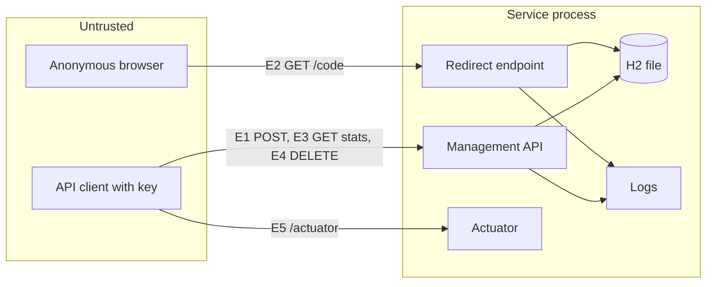

# Threat model

| Field | Value |
|---|---|
| System | url-shortener, one JVM, H2 file database |
| Owner | Harshil |
| Date | 2026-10-12 |
| Method | Data flow diagram with trust boundaries, STRIDE per element, accepted risks with an owner, the four-question check from the Threat Modeling Manifesto |

## What are we working on

| Element | Entry | Trust |
|---|---|---|
| E1 create | `POST /api/v1/links` | API key required; body untrusted |
| E2 redirect | `GET /{code}`, `HEAD /{code}` | Public by design; path constrained by regex |
| E3 stats and metadata | `GET /api/v1/links/{code}`, `GET .../stats` | API key required |
| E4 delete | `DELETE /api/v1/links/{code}` | API key required |
| E5 actuator | `/actuator/**` | Health public; info, metrics, Prometheus behind the key in prod |
| DB file | `./data/urlshortener.mv.db` | Local file, same user as the process |
| Logs | stdout, structured JSON in prod | User-controlled values pass through `LogSanitizer` |

## What can go wrong

| Element | Spoofing | Tampering | Repudiation | Information disclosure | Denial of service | Elevation | Status |
|---|---|---|---|---|---|---|---|
| E1 create | Stolen or guessed API key | Malicious target URL | No per-user identity | Target URLs are not secret | Mass creation, oversized bodies | None | Rate limit before auth; validation; size cap; accepted: single shared key |
| E2 redirect | None | None | None | Enumeration of codes | Redirect floods | None | Random codes; path regex; accepted: public by design |
| E3 stats | Stolen key | None | None | Click data per link | Expensive queries | None | Key; single indexed query; no PII stored |
| E4 delete | Stolen key | Delete others' links | No audit of who | None | None | None | Key; accepted: shared key, no per-user audit in prototype |
| E5 actuator | None in dev | None | None | Metrics and env in prod | None | None | API key in prod; env contributor disabled |
| DB file | None | Local file edit | None | Readable by local user | Disk full | None | Accepted: local prototype; file permissions documented |
| Logs | None | Log injection | None | URL query strings | Log flood | None | Sanitiser; no full URLs; rate limit |

## What are we doing about it

| Control | Covers | Where |
|---|---|---|
| Redirect only to the stored URL validated at create; scheme allow-list; non-enumerable codes | E2 open redirect (CWE-601) | `UrlValidator`, `RedirectController`, `CodeGenerator` |
| Reject loopback, private, link-local, `0.0.0.0/8`, multicast, metadata hosts, `localhost`, user info, over 2048 characters | E1 intranet link laundering | `UrlValidator` |
| Rate limiter before the security chain, per client IP, Caffeine-bounded | E1 key guessing, mass creation; Logs flood | `RateLimitFilter` |
| API key with constant-time compare; prod fails fast without a key; `WWW-Authenticate` on 401 | E1, E3, E4, E5 access | `SecurityConfig` |
| 16 KiB body cap on `/api/v1/**`; 2-second connection timeout; bounded click executor | E1 and E2 resource consumption | `RequestSizeFilter`, properties, `ClickRecorderExecutorConfig` |
| `LogSanitizer`; no full target URLs in logs; request id bounded to 64 characters of `[A-Za-z0-9-]` | Logs injection (CWE-117), disclosure | `LogSanitizer`, `RequestIdFilter` |
| JPA parameter binding only; FindSecBugs in the build | Injection | repositories, SAST gate |
| No IP or user agent persisted | E3 disclosure, privacy | Schema, ADR 0006 |
| Headers: `nosniff`, `X-Frame-Options: DENY`, `Referrer-Policy: no-referrer`, CSP scoped to Swagger UI | Browser-side attacks | Spring Security headers |
| Actuator exposure explicit; H2 console dev only; stack traces never in responses | E5 misconfiguration | properties, `ApiExceptionHandler` |
| No secrets in repo; gitleaks in CI; HC-10 regex fallback; `.gitignore` for `.env*`, `data/`, `*.mv.db` | Secrets, DB file in git | repo, CI, harness-check |

The security controls table with one row per threat is in [architecture.md](architecture.md#security-controls).

## Accepted risks

Owner for every item: Harshil.

| Risk | Reason accepted |
|---|---|
| One shared API key, no per-user identity (E1, E3, E4) | Not in the brief; one key suffices for a prototype and is listed as a limitation |
| No audit of who deleted a link (E4) | There is no user identity to record; recorded as a limitation |
| Redirect endpoint is public (E2) | A shortener's purpose; random codes and the path regex are the controls |
| Open redirect by design (RK-09) | Inherent to the product; validation, non-enumerable codes, and rate limits are the controls |
| A hostname that later resolves to a private address passes validation | No DNS resolution at create by design; the service never fetches, so the threat is laundering, not SSRF |
| H2 file readable and editable by the local user | Local prototype; file permissions documented |
| Click events dropped under saturation or lost after the 10-second drain (RK-11) | Counted in `shortener.clicks.dropped`; analytics tolerate loss, redirects do not |
| Deleted alias can be re-registered by another party (RK-12) | Hard delete in the timebox; candidate for T-105 only if it surfaces as a defect |
| Users behind one NAT share a rate-limit bucket; buckets reset on restart | In-process limiter; no external infrastructure for reviewers |
| HSTS not visible on local HTTP | Reviewers run plain HTTP; the header appears only on HTTPS |
| Native Windows runs the AI assistant unsandboxed (SAI-11) | Deny rules and manual approval are the controls; stated in the policy |

## Did we do a good enough job

| Check | Evidence |
|---|---|
| Every E1 to E5 threat has a control or an accepted-risk row above | This document |
| Controls are tested, not described | `ApiKeyIT`, `RateLimitIT.limitsUnauthenticatedCreates`, `SecurityHeadersIT`, `UrlValidatorTest`, `ProblemDetailIT`, `ProdStartupIT`, `ClickRecorderExecutorTest` |
| Static analysis finds no unreviewed sink | SpotBugs with FindSecBugs, effort max, threshold medium, exclusions committed with reasons |
| Secrets never enter history | gitleaks in CI with full history; HC-10 in the default build |
| Security-touching tasks had a second look | Reason code `security` forces a fresh-context review artifact and a sign-off (T-007 and any later change) |
| Residual risks have an owner | Accepted risks table above |
| Results | Gate and test outcomes filled at submission from the traceability report |
